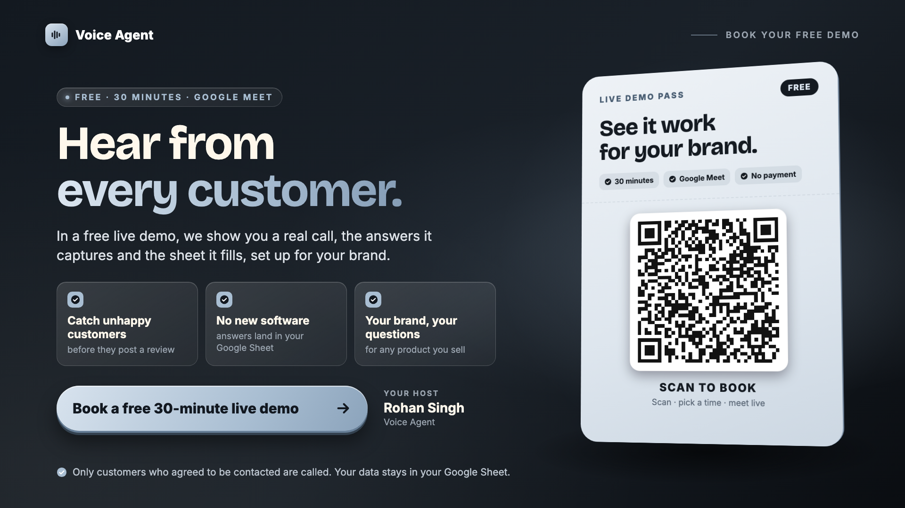

# n8n Voice Agent: AI feedback calls after delivery

An AI voice agent that phones customers a few days after their order is delivered, runs a short
feedback survey, and writes the score, the customer's exact words and a summary straight into
Google Sheets. n8n orchestrates the whole pipeline on a self-hosted Google Cloud server with
Postgres, signed webhooks, nightly backups and monitoring.

[](docs/demo-video.mp4)

**[Watch the demo video](docs/demo-video.mp4)** (2.5 min, includes a real recorded call).
"Aurelia Perfumes" in the demo is a fictional brand.

## How it works

1. **Order sheet:** delivered orders sit in a Google Sheet (`Outreach_Queue`) with the customer's
   name, phone, product and whether they agreed to be called.
2. **n8n scheduler:** every minute n8n reads the queue and picks rows that are `Pending`, have
   permission, and are due. It marks each row `Dialing` first, so no customer is called twice.
3. **AI voice call:** n8n asks a Dograh voice agent ("Meera") to call the customer through Twilio.
   She confirms the name, asks about the product (experience, longevity, others noticing it,
   repurchase intent), and finishes with a 0-10 recommend score.
4. **Signed webhook:** when the call ends, Dograh posts the results back to n8n. The webhook only
   accepts requests carrying a secret `Authorization: Bearer` header (anything else gets `403`).
5. **Feedback sheet:** n8n saves the score, quote, summary and call details to the `Feedback` and
   `Call_Attempts` tabs and marks the order `Completed`. Failed calls are marked and retried later.
6. **Error alerts:** a separate error workflow writes any failure (node, message, execution link)
   to an `Errors` tab.

## Architecture


One VM, three containers, one domain. Only Caddy is reachable from the internet.

| Part | What it does |
|---|---|
| **Caddy** | HTTPS with automatic Let's Encrypt certificates, reverse proxy, hides `/metrics` |
| **n8n 2.41.6** (version pinned) | Runs the `Voice-Agent` and `Voice-Agent Error Alerts` workflows; credentials encrypted at rest |
| **Postgres 16** | n8n's database: workflows, encrypted credentials, execution history |
| **Dograh** | Hosted voice-AI platform: speech-to-text, LLM, text-to-speech, call flow, Twilio telephony |
| **Google Sheets** | The brand's queue and results; no new software for the client to learn |

## Production details

- **Docker Compose stack** (`deploy/docker-compose.yml`) with secrets in a `chmod 600` `.env`; the whole deployment moves as one folder.
- **Migrated from SQLite to Postgres** with zero data loss (workflows, credentials, about 4,900 executions), including resetting Postgres sequences after import.
- **Signed webhooks:** Bearer-token header auth on the inbound webhook; the Dograh API key is stored as an n8n credential, never in the workflow.
- **Backups:** nightly `pg_dump` + workflow export (14 days), daily Google Cloud disk snapshots (14 days), and a **restore drill script** that restores the latest backup into a throwaway Postgres and compares row counts with production.
- **Monitoring:** Google Cloud Ops Agent + a Cloud Monitoring dashboard (`monitoring/gcp-dashboard.json`) for memory, disk, logs and n8n metrics.
- **Demo tooling:** a one-command pre-flight check and demo reset (`deploy/scripts/demo-reset.sh`): container health, HTTPS, disk, backup freshness, workflows published, webhook rejects unsigned calls, and a clean demo sheet.
- **Client-ready:** the same bundle deploys a fresh copy on a client's own Google Cloud account (Path B in the deployment guide).

## Tech stack

n8n · Dograh AI · Twilio · Google Sheets API · PostgreSQL · Docker Compose · Caddy · Google Cloud
(Compute Engine, Cloud Monitoring) · Python · Bash · Remotion (React) for the demo video

## Repository layout

```text
deploy/                Deployment bundle and full guide (start with deploy/README.md)
  docker-compose.yml   Postgres + n8n + Caddy
  Caddyfile            HTTPS reverse proxy
  .env.example         Settings and secrets template
  workflows/           The n8n workflows (no secrets; credentials referenced by name)
  scripts/             install, import/export, backup, restore, restore test, demo reset
  diagrams/            Architecture and deployment roadmap
monitoring/            Google Cloud Monitoring dashboard
demo-video/            Source of the explainer video (Remotion + real call audio)
docs/                  Demo video, thumbnail, architecture image
learning/              Hand-drawn study notes made while building it (webhook auth, SSH keys,
                       backups, the step-by-step server upgrade, how the video was made)
```

## Run it yourself

You need a Google Cloud (or any Linux) server, a domain or `sslip.io` hostname, a Dograh account with
a published voice agent, and a Google Sheet with the tabs described in the guide.

```bash
cd deploy
cp .env.example .env && chmod 600 .env        # fill DOMAIN, N8N_ENCRYPTION_KEY, DB_PASSWORD
sudo ./scripts/install-docker.sh
sudo docker compose up -d
sudo ./scripts/import.sh workflows/Voice-Agent.json
```

Then in n8n: create the `Google Sheets account` and `Header Auth account` credentials, set your Sheet
ID and Dograh agent trigger, and publish. The complete step-by-step guide (8 phases: server,
domain, stack, migration, Dograh hookup, backups, monitoring, handover) is in
[deploy/README.md](deploy/README.md).

## Notes

- No credentials, keys, phone numbers or server addresses are included. Placeholders such as
  `YOUR_GOOGLE_SHEET_ID`, `YOUR_DOGRAH_TRIGGER_UUID` and `n8n.example.com` mark what to fill in.
- Only customers who agreed to be contacted are called (`permission_to_call = Yes`).
