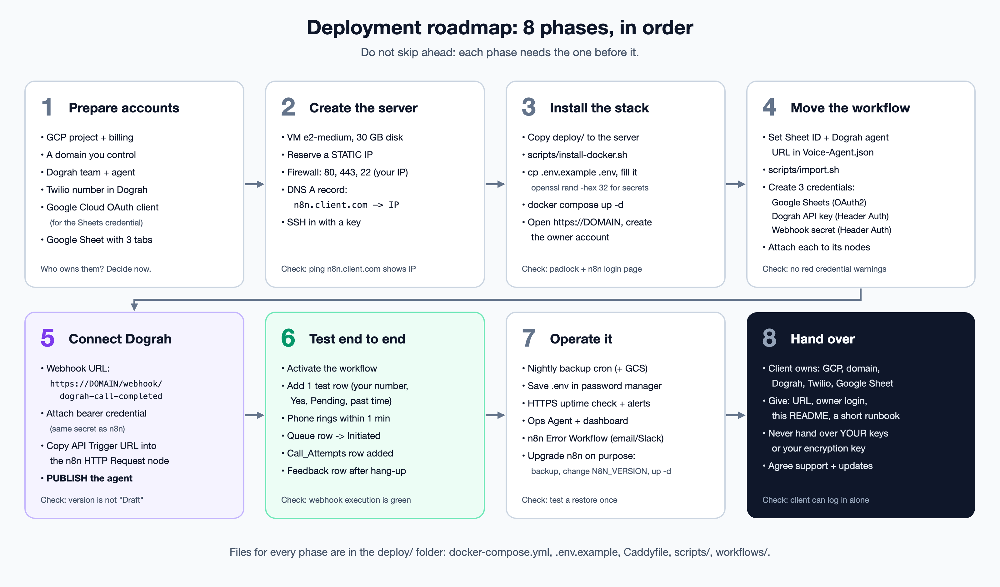
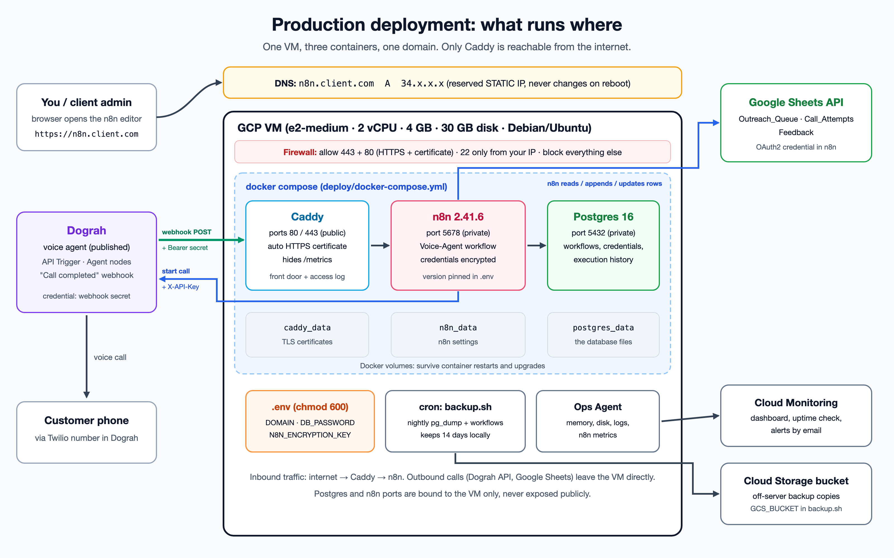

# Complete deployment guide: n8n + Dograh voice agent

This folder is a ready-to-use deployment bundle. Use it for two jobs:

- **Path A: make YOUR current server production-ready** (static IP, real domain, Postgres, backups).
- **Path B: deploy a fresh copy for a CLIENT** on their own cloud account.

Both paths follow the same 8 phases. Where they differ, the step says "Path A" or "Path B".



## What you get



| File | Purpose |
|---|---|
| `docker-compose.yml` | Runs 3 containers: Postgres 16, n8n (pinned version), Caddy (HTTPS) |
| `.env.example` | Template for secrets and settings. Copy to `.env` on the server |
| `Caddyfile` | HTTPS reverse proxy. Gets a certificate automatically, hides `/metrics` |
| `workflows/Voice-Agent.json` | Your workflow, **without any secrets** (credentials are only referenced by name) |
| `scripts/install-docker.sh` | Installs Docker + Compose on a fresh Debian/Ubuntu server |
| `scripts/export-from-old-server.sh` | Path A: exports workflows + credentials from the current single container |
| `scripts/import.sh` | Imports workflows (and optionally credentials) into the new stack |
| `scripts/backup.sh` | Nightly Postgres dump + workflow JSON, optional upload to Cloud Storage |
| `scripts/restore.sh` | Restores a dump made by `backup.sh` |

### Why this setup is better than what runs today

| Today | After this deployment | Why it matters |
|---|---|---|
| Ephemeral IP `YOUR_SERVER_IP` + `sslip.io` | Static IP + your own domain | IP can change on VM stop/start and break every webhook URL |
| SQLite file inside the container | Postgres container | Safer under load, proper backups with `pg_dump` |
| `n8n:latest` | Pinned `N8N_VERSION` | No surprise upgrades that break nodes |
| One long `docker run` command | `docker-compose.yml` + `.env` | Reproducible: same stack on any server in minutes |
| No backups | Nightly backup + off-server copy | One bad disk or mistake no longer loses everything |
| Caddy installed on the host | Caddy in the stack | Whole deployment moves as one folder |

---

## Phase 1: Prepare accounts

Decide **who owns each account**. For a client, the client should own all of them and invite you.

| Account | Needed for | Path B note |
|---|---|---|
| Google Cloud project + billing | The VM, static IP, monitoring, backup bucket | Client's project; add you as Editor |
| Domain (any registrar) | `n8n.clientdomain.com` | Client adds one DNS record |
| Dograh team | The voice agent, API key, webhooks | Client's team; agent rebuilt or duplicated there |
| Twilio number (connected in Dograh) | Outbound phone calls | Client pays for minutes |
| Google Cloud OAuth client | The Google Sheets credential in n8n | Created in the client's GCP project |
| Google Sheet | Queue, attempts, feedback data | Client's Google Drive |

### Google Sheet: 3 tabs, exact header row

Create the sheet with these tabs and these column headers in row 1:

| Tab | Columns (row 1) |
|---|---|
| `Outreach_Queue` | order_id, customer_id, customer_name, phone_e164, product_name, purchase_date, delivery_date, permission_to_call, scheduled_call_at, queue_status, attempt_count, next_attempt_at |
| `Call_Attempts` | attempt_id, order_id, customer_id, dograh_run_id, started_at, ended_at, duration_seconds, call_outcome, failure_reason |
| `Feedback` | feedback_id, attempt_id, order_id, customer_id, nps, liked, disliked, repurchase_intent, follow_up_requested, exact_quote, summary, captured_at |
| `Errors` | time, workflow, failed_node, error_message, execution_id, execution_url |

Keep the tab IDs (gid) identical to the template (`Outreach_Queue` 0, `Call_Attempts` 1500231701, `Feedback`
684645729, `Errors` 900000001) by creating the sheet through the Sheets API, or simply re-select each tab in
the Google Sheets nodes after import.

Formats the workflow expects: `phone_e164` like `+91XXXXXXXXXX`, `permission_to_call` = `Yes`,
`queue_status` = `Pending`, `scheduled_call_at` like `2026-10-09 14:00:00` (IST), `attempt_count` = `0`.

The **Sheet ID** is the long part of the sheet URL: `docs.google.com/spreadsheets/d/<SHEET_ID>/edit`.

---

## Phase 2: Create the server

Run these from your Mac with `gcloud` logged in to the right project
(`gcloud config set project <PROJECT_ID>`).

### Path A: upgrade the existing VM `n8n-vm`

**Done on 9 Oct 2026:** snapshot `n8n-before-demo-upgrade-20261009`, static IP `n8n-voice-agent-ip`
(`YOUR_SERVER_IP`), disk grown to 30 GB online. **Done on 11 Oct 2026:** the stack runs from
`/opt/voice-agent` (Phases 3, 4 and 7). For reference, the equivalent commands:

```bash
# 1. Restore point
gcloud compute disks snapshot n8n-vm --zone=asia-south1-c --snapshot-names=n8n-before-upgrade

# 2. Keep the SAME IP but make it static (no webhook URL changes because of the IP)
gcloud compute addresses create n8n-voice-agent-ip --addresses=YOUR_SERVER_IP --region=asia-south1

# 3. Grow the disk to 30 GB, then grow the partition + filesystem without a reboot (on the VM)
gcloud compute disks resize n8n-vm --size=30GB --zone=asia-south1-c
sudo apt-get install -y cloud-guest-utils && sudo growpart /dev/sda 1 && sudo resize2fs /dev/sda1
```

### Path B: new VM for a client

```bash
gcloud compute addresses create n8n-ip --region=asia-south1
gcloud compute instances create n8n-prod \
  --zone=asia-south1-c --machine-type=e2-medium \
  --image-family=debian-12 --image-project=debian-cloud \
  --boot-disk-size=30GB --address=n8n-ip --tags=web
gcloud compute firewall-rules create allow-web --allow=tcp:80,tcp:443 --target-tags=web
gcloud compute addresses describe n8n-ip --region=asia-south1 --format='value(address)'
```

### Both paths: DNS and firewall

1. At the domain registrar add an **A record**: name `n8n` (or any subdomain) -> the static IP.
2. Wait until `dig +short n8n.clientdomain.com` prints the IP (usually 1 to 15 minutes).
3. Firewall: ports 80 and 443 open to everyone (Caddy needs 80 for the certificate).
   Restrict SSH (22) to your own IP in VPC network -> Firewall when possible.

No domain yet? You can keep `<ip-with-dashes>.sslip.io` as DOMAIN. It works with the static IP,
but use a real domain for clients.

---

## Phase 3: Install the stack

```bash
# From your Mac: copy this folder to the server
scp -r deploy <user>@<SERVER_IP>:~/voice-agent

# On the server
ssh <user>@<SERVER_IP>
cd ~/voice-agent
./scripts/install-docker.sh          # log out and back in afterwards if it says so

cp .env.example .env && chmod 600 .env
openssl rand -hex 32                 # copy into N8N_ENCRYPTION_KEY (Path B only, see below)
openssl rand -hex 32                 # copy into DB_PASSWORD
nano .env                            # set DOMAIN, ACME_EMAIL, the two secrets
```

**Path A, important:** set `N8N_ENCRYPTION_KEY` to the **old** key, otherwise your exported credentials
cannot be decrypted. Read it on the old server with `sudo docker exec n8n printenv N8N_ENCRYPTION_KEY`
and paste it straight into `.env`. Never paste it into chat.

**Path A:** do not start everything yet. Follow "Path A: full database move" in Phase 4, which also
frees ports 80, 443 and 5678 used by the old setup. **Path B:** start everything:

```bash
docker compose up -d
docker compose ps                       # all 3 should be "running" / "healthy"
docker compose logs -f caddy            # look for "certificate obtained successfully", then Ctrl+C
```

Open `https://<DOMAIN>`. You should see a padlock and the n8n setup screen. Create the **owner account**
(for a client: their email, they change the password later).

---

## Phase 4: Move the workflow

### Path A: full database move (done on 11 Oct 2026, about 2 minutes downtime)

Moves everything from the old SQLite database into Postgres: owner login, credentials, workflows,
published versions and execution history. The new and old n8n must be the **same version**.

```bash
# 1. stop the old n8n so nothing changes during the export; keep it as the rollback
sudo docker update --restart=no n8n && sudo docker stop n8n

# 2. export with a one-off container that uses the old data volume and the same encryption key
sudo docker run --rm --env-file .env --volumes-from n8n docker.n8n.io/n8nio/n8n:2.41.6 \
  export:entities --outputDir=/home/node/.n8n/migration --includeExecutionHistoryDataTables=true

# 3. start n8n once on Postgres so it creates the empty tables, then stop it
sudo docker compose up -d n8n && sleep 20 && sudo docker compose stop n8n

# 4. import (the folder must be writable: the zip is unpacked next to itself)
sudo mkdir -p /var/tmp/n8n-import && sudo cp /var/lib/docker/volumes/n8n_data/_data/migration/entities.zip /var/tmp/n8n-import/
sudo chown -R 1000:1000 /var/tmp/n8n-import
sudo docker compose run --rm --no-deps -v /var/tmp/n8n-import:/migration n8n \
  import:entities --inputDir=/migration --truncateTables=true

# 5. REQUIRED: move Postgres id counters past the imported rows, otherwise new executions fail silently
sudo docker compose exec -T postgres psql -U n8n -d n8n < scripts/fix-sequences.sql

# 6. reuse the old HTTPS certificate, retire the host Caddy, start everything
sudo docker compose create caddy
sudo mkdir -p /var/lib/docker/volumes/voice-agent_caddy_data/_data/caddy
sudo cp -a /var/lib/caddy/.local/share/caddy/. /var/lib/docker/volumes/voice-agent_caddy_data/_data/caddy/
sudo systemctl disable --now caddy
sudo docker compose up -d
```

Rollback: `sudo docker compose down && sudo systemctl enable --now caddy && sudo docker update --restart=unless-stopped n8n && sudo docker start n8n`.

Alternative (workflows + credentials only, no login or history): `./scripts/export-from-old-server.sh` on
the old server, then `./scripts/import.sh ~/n8n-migration/workflows.json ~/n8n-migration/credentials.json`.

If DOMAIN changed, reconnect Google: in Google Cloud Console -> APIs & Services -> Credentials -> your
OAuth client, add the redirect URI `https://<DOMAIN>/rest/oauth2-credential/callback`, then in n8n open
**Google Sheets account** and click **Sign in with Google** again.

### Path B: fresh install for a client

1. Point the template at the client's sheet and Dograh agent (on the server):
   ```bash
   sed -i 's/YOUR_GOOGLE_SHEET_ID/<CLIENT_SHEET_ID>/g; s/YOUR_DOGRAH_TRIGGER_UUID/<CLIENT_AGENT_UUID>/g' workflows/Voice-Agent.json
   ./scripts/import.sh workflows/Voice-Agent.json
   ```
   The file contains two workflows: **Voice-Agent** and **Voice-Agent Error Alerts** (logs every failed run to
   the `Errors` tab). Publish both: in n8n 2.x an error workflow that is not published is silently skipped.
   ```bash
   docker compose exec -u node n8n n8n publish:workflow --id=TXLzcvYVqXg831DW
   docker compose exec -u node n8n n8n publish:workflow --id=vaErrorAlerts001
   docker compose restart n8n
   ```
   `<CLIENT_AGENT_UUID>` is the last part of the API Trigger URL in the client's Dograh agent.
2. Create the 3 credentials in n8n (Overview -> Credentials -> Create):

| Credential name (exactly) | Type | Fields | Used by nodes |
|---|---|---|---|
| `Google Sheets account` | Google Sheets OAuth2 API | Client ID + Secret from the client's OAuth client, then **Sign in with Google** | Get row(s), Append row, Update row, Append or update row |
| `Header Auth account` | Header Auth | Name `X-API-Key`, Value = client's Dograh API key, Allowed domains `api.dograh.com` | HTTP Request |
| `Dograh webhook secret` | Header Auth | Name `Authorization`, Value `Bearer <openssl rand -hex 32>` | Call Completed (webhook) |

   Google OAuth client setup (client's GCP project): enable **Google Sheets API** and **Google Drive API**,
   configure the OAuth consent screen, create an **OAuth client ID** of type *Web application* with the
   redirect URI `https://<DOMAIN>/rest/oauth2-credential/callback`.
3. Open each node in the workflow and pick its credential from the dropdown. Save.

---

## Phase 5: Connect Dograh

In the Dograh agent (Path B: in the client's Dograh team):

1. **Credentials** -> create `n8n feedback receiver`, type `bearer_token`, token = the same secret you put
   after `Bearer ` in n8n's `Dograh webhook secret`.
2. **"Call completed" webhook node**: URL `https://<DOMAIN>/webhook/dograh-call-completed`
   (production URL, not `/webhook-test/`), method POST, credential `n8n feedback receiver`.
3. **API Trigger node**: copy its URL. It must match the URL in n8n's **HTTP Request** node.
4. **Telephony**: the Twilio number is connected and active.
5. Click **Publish**. The version badge must no longer say "Draft".

---

## Phase 6: Test end to end

1. In n8n, open **Voice-Agent** and switch it to **Active / Published**.
2. Add one row to `Outreach_Queue`: your own phone, `permission_to_call` = `Yes`, `queue_status` = `Pending`,
   `scheduled_call_at` a few minutes in the past, `attempt_count` = `0`.
3. Check, in order:

| Within | You should see | If not, look at |
|---|---|---|
| 1 min | Your phone rings | n8n Executions (trigger run): HTTP Request node error |
| 1 min | Queue row -> `Initiated`, `attempt_count` = 1 | Update row node |
| 1 min | New row in `Call_Attempts` with `dograh_run_id` | Append row node |
| 10 s after hang-up | New row in `Feedback` with nps, quote, summary | n8n Executions (webhook run). Empty? See the status-code guide in `../learning/webhook-auth/` |

Useful on the server: `docker compose logs --tail 100 n8n` and `docker compose logs --tail 50 caddy`.

---

## Phase 7: Operate it

### Backups (do this on day one)

```bash
# Optional off-server copy: create a bucket once (the VM service account needs Storage Object Admin on it)
gcloud storage buckets create gs://<project>-voice-agent-backups --location=asia-south1

# Nightly at 02:30 server time
sudo crontab -e
30 2 * * * cd /home/<user>/voice-agent && GCS_BUCKET=<project>-voice-agent-backups ./scripts/backup.sh >> /var/log/voice-agent-backup.log 2>&1
```

Store a copy of `.env` (especially `N8N_ENCRYPTION_KEY`) in a password manager. A database backup without
that key cannot decrypt any credential. Prove the backups work without touching the live system:
`sudo ./scripts/restore-test.sh` (throwaway Postgres, compares counts). Real restore: `./scripts/restore.sh <file>.sql.gz`.
Full explanation: `../learning/backups/README.md`.

Before a demo: `sudo ./scripts/demo-reset.sh` resets the demo sheet and runs pre-flight checks
(`--check` = checks only). The sheet ID, Dograh workflow ID and demo rows are constants at the top of `demo_reset.py`.

### Monitoring

- **Uptime check:** Cloud Monitoring -> Uptime checks -> HTTPS, host `<DOMAIN>`, path `/healthz`,
  with an email alert. You hear about downtime before the client does.
- **Ops Agent + dashboard:** same setup as on the current VM (memory, disk, logs, n8n metrics).
  The Prometheus scrape target stays `127.0.0.1:5678`, because the compose file binds n8n to localhost.
  Path A: Caddy now logs to Docker instead of `/var/log/caddy/caddy.log`, so remove the `caddy_log`
  receiver from `/etc/google-cloud-ops-agent/config.yaml`. The `n8n_docker` receiver already picks up
  all three containers' logs.
- **n8n Error Workflow:** create a workflow with an **Error Trigger** -> Gmail/Slack message, then in
  Voice-Agent -> Settings -> Error workflow, select it. Any failed run notifies you.

### Upgrading n8n (on purpose, never automatic)

```bash
./scripts/backup.sh
nano .env                      # N8N_VERSION=<new version>, read the n8n release notes first
docker compose pull n8n && docker compose up -d n8n
docker compose logs -f n8n     # wait for "Editor is now accessible", then run a test call
```

Rollback: set the old `N8N_VERSION` back, `docker compose up -d n8n`, and if the database was migrated,
`./scripts/restore.sh` the backup you just took.

### Before real customers: remaining workflow gaps

Already fixed in the template (10 Oct 2026): rows go `Dialing` before the call (no double-dial), `Failed` if
Dograh refuses, `Completed` after feedback, Call_Attempts gets ended_at / duration / outcome, and failed runs
are logged to the `Errors` tab.

- Retries: use `next_attempt_at` + a max `attempt_count` for no-answer calls.
- Email/Slack alerts: add a Gmail or Slack node to **Voice-Agent Error Alerts** (needs that credential).
- Polling every minute is fine at small volume; widen to 5 minutes or use a Sheets trigger at scale.

---

## Phase 8: Hand over to the client

Give the client:

- The URL `https://<DOMAIN>` and the owner login (they set their own password).
- This README plus a one-page runbook: how to add rows, what each status means, who to call.
- Confirmation that **they own** the GCP project, domain, Dograh team, Twilio number and Google Sheet.

Never hand over (or reuse for them): **your** Dograh API key, **your** Google OAuth tokens, **your**
`N8N_ENCRYPTION_KEY`, or your n8n database. Every client gets fresh secrets.

Agree in writing: who pays which bills, who applies n8n upgrades, backup retention, and support hours.

---

## Quick reference

```bash
docker compose ps                    # status of the 3 containers
docker compose logs -f n8n           # live n8n logs
docker compose restart n8n           # restart only n8n
docker compose down                  # stop everything (data stays in volumes)
docker compose up -d                 # start everything
./scripts/backup.sh                  # manual backup
```
