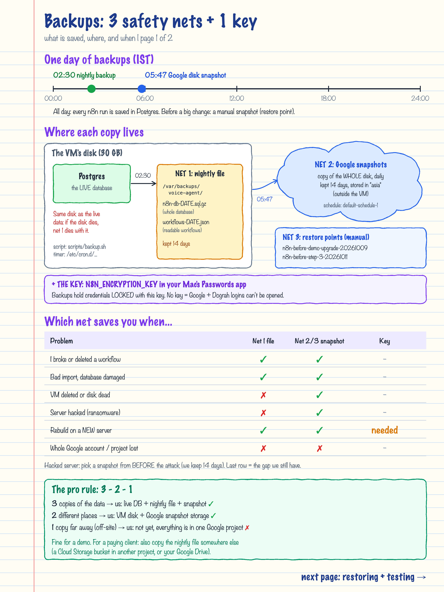
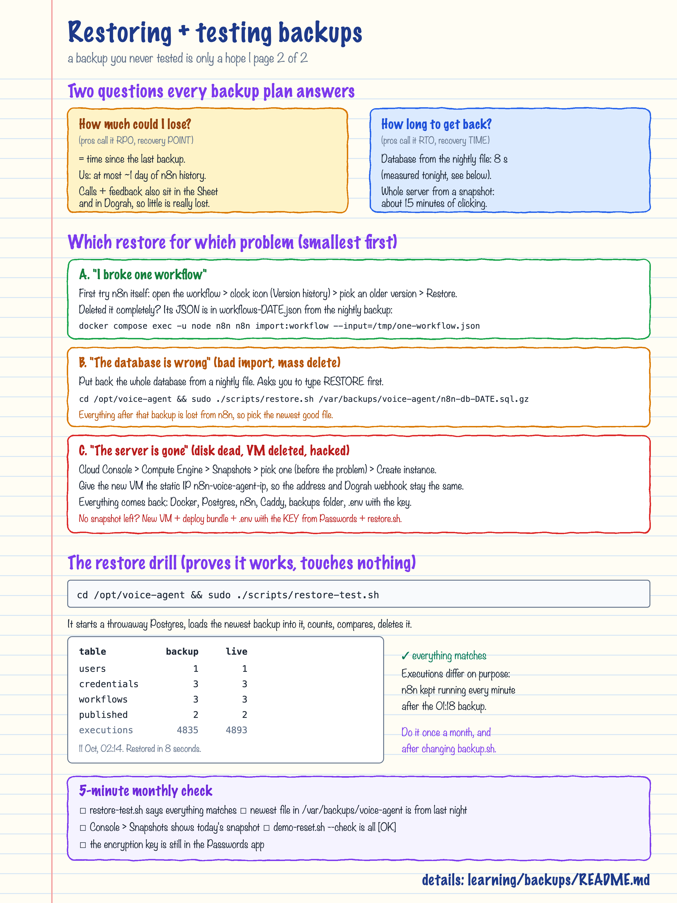

# Backups: what is saved, where, and how to get it back

Server: `n8n-vm` (YOUR_SERVER_IP). Set up in Path A Step 3 (11 Oct 2026). Restore drill passed on 11 Oct.

## TL;DR

| Safety net | What | When | Kept | Where |
|---|---|---|---|---|
| 1. Nightly file | Whole n8n database (`n8n-db-DATE.sql.gz`) + all workflows as JSON (`workflows-DATE.json`) | 02:30 IST, by `scripts/backup.sh` | 14 days | `/var/backups/voice-agent` on the VM's own disk |
| 2. Disk snapshot | A copy of the whole 30 GB disk (OS, Docker, data, backups folder, `.env`) | About 05:47 IST, by Google (schedule `default-schedule-1`) | 14 days | Google snapshot storage, region "asia" (outside the VM) |
| 3. Restore points | Manual snapshots before risky changes | Before Step 1 and Step 3 so far | Until deleted | Same as 2 |
| + The key | `N8N_ENCRYPTION_KEY` | Saved once | Forever | Passwords app on your Mac |

A backup has never really worked until you restore it once. That was done on 11 Oct: the 01:18 backup came back
in **8 seconds** with the same users, credentials and workflows as the live system.




---

## 1. Why more than one net

Each copy protects against different accidents:

| Problem | Net 1: nightly file | Net 2/3: snapshot | Key |
|---|---|---|---|
| I broke or deleted a workflow | yes | yes | - |
| Bad import, database damaged | yes | yes | - |
| VM deleted or disk dead | **no** (same disk) | yes | - |
| Server hacked / ransomware | no | yes, pick one from before the attack | - |
| Rebuild on a brand-new server | yes | yes | **needed** |
| Whole Google account or project lost | no | no | - |

- **Net 1 lives on the same disk as the live data.** It is fast and precise (one file, restore in seconds), but if
  the disk dies it dies too.
- **Net 2 lives outside the VM**, so it survives a dead disk or a deleted VM. It restores everything at once.
- **The key** is not a backup of data, but without it any restored credential (Google login, Dograh key, webhook
  secret) cannot be decrypted, and every node using them fails.

### The 3-2-1 rule

Professionals aim for **3** copies, on **2** different kinds of storage, with **1** far away.
We have 3 copies (live, nightly file, snapshot) in 2 places (VM disk, snapshot storage) but no copy outside this
Google project yet. That is fine for a demo. For a paying client, also copy the nightly file to a Cloud Storage
bucket in a different project (the `GCS_BUCKET` option in `backup.sh`) or to Google Drive.

## 2. What exactly is inside each backup

**`n8n-db-DATE.sql.gz`** is a `pg_dump`: the SQL commands that rebuild every table (users, credentials, workflows,
published versions, execution history, settings). Credentials inside are encrypted with the key. Size tonight: 1.6 MB.

**`workflows-DATE.json`** is the output of `n8n export:workflow --all`: readable JSON of every workflow. Handy for
looking at an old version or copying one workflow back.

**The disk snapshot** is a block-level copy of the whole disk. Google stores only the changes between snapshots,
which is why they are small (100-400 MB each) and cheap.

Also in `/var/backups/voice-agent`: `demo-sheet-before-reset-DATE.json`, written by `demo-reset.sh` before it
cleans the demo spreadsheet (see the Step 5 journal). All files are readable by root only.

## 3. How it runs (the moving parts)

```bash
# The timer: one line in /etc/cron.d/voice-agent-backup
30 2 * * * root /opt/voice-agent/scripts/backup.sh >> /var/log/voice-agent-backup.log 2>&1
#  ^  ^ ^ ^ ^
#  |  | | | +-- every weekday
#  |  | | +---- every month
#  |  | +------ every day of the month
#  |  +-------- hour 2
#  +----------- minute 30

# What backup.sh does, in short
docker compose exec -T postgres pg_dump -U n8n -d n8n --clean --if-exists | gzip > n8n-db-STAMP.sql.gz
docker compose exec -T -u node n8n n8n export:workflow --all --pretty --output=/tmp/workflows.json
find /var/backups/voice-agent -type f -mtime +14 -delete      # forget files older than 14 days
```

The snapshot schedule is a Google Cloud *resource policy* attached to the disk: Compute Engine -> Snapshots ->
Snapshot schedules -> `default-schedule-1` (daily, 14 days, keep snapshots if the disk is deleted).

## 4. Restoring: smallest fix first

### A. One workflow is broken

1. In n8n, open the workflow -> clock icon (**Version history**) -> choose an older version -> **Restore**.
   n8n keeps this history itself; no backup needed.
2. Deleted the whole workflow? Take its JSON from the newest `workflows-DATE.json` (it is a list; copy the one
   workflow object into its own file), then:

```bash
cd /opt/voice-agent
sudo docker compose cp /tmp/one-workflow.json n8n:/tmp/one-workflow.json
sudo docker compose exec -u node n8n n8n import:workflow --input=/tmp/one-workflow.json
sudo docker compose exec -u node n8n n8n publish:workflow --id=<workflow id>
sudo docker compose restart n8n
```

### B. The database is wrong (bad import, mass delete, broken upgrade)

```bash
cd /opt/voice-agent
sudo ls -la /var/backups/voice-agent                                   # pick the newest GOOD file
sudo ./scripts/restore.sh /var/backups/voice-agent/n8n-db-DATE.sql.gz  # type RESTORE to confirm
```

It stops n8n, replaces the database, and starts n8n again. Everything n8n saved after that backup is gone
(the Sheet and Dograh still have the calls). The `.env` key must be the one in use when the backup was taken;
on this server it has never changed.

### C. The server is gone (disk dead, VM deleted, hacked)

1. Cloud Console -> Compute Engine -> **Snapshots** -> pick the newest one from **before** the problem ->
   **Create instance** (zone asia-south1-c, same machine type).
2. Networking: give it the static IP **n8n-voice-agent-ip**, so `https://n8n.example.com` and the Dograh
   webhook keep working without changes.
3. Start it. Docker, the three containers, the backups folder and `.env` are all on the restored disk.
4. Check: `sudo /opt/voice-agent/scripts/demo-reset.sh --check`.

No snapshot available? New VM -> deploy bundle (Phase 3 of `deploy/README.md`) -> `.env` with the **key from the
Passwords app** -> copy a nightly file over -> `restore.sh`.

## 5. Testing: the restore drill

```bash
cd /opt/voice-agent && sudo ./scripts/restore-test.sh             # newest backup
sudo ./scripts/restore-test.sh /var/backups/voice-agent/n8n-db-DATE.sql.gz
```

It starts a throwaway Postgres container, loads the backup into it, compares the important counts with the live
database, and deletes the container. The live system is not touched. Result on 11 Oct 2026:

```text
table            backup       live
users                 1          1
credentials           3          3
workflows             3          3
published             2          2
executions         4835       4893     <- live is higher: n8n kept running after the 01:18 backup
Restored in 8 s
```

## 6. Monthly 5-minute check

- [ ] `sudo ./scripts/restore-test.sh` shows matching counts.
- [ ] `sudo ls -la /var/backups/voice-agent` has a file from last night.
- [ ] `sudo tail /var/log/voice-agent-backup.log` ends with "Backup written to ...".
- [ ] Cloud Console -> Snapshots shows one from today.
- [ ] `sudo ./scripts/demo-reset.sh --check` is all `[OK]` (it also warns if the newest backup is older than 26 h).
- [ ] The encryption key is still in the Passwords app.

## Words

- **Backup**: a copy you can go back to. **Restore**: putting a copy back.
- **pg_dump**: Postgres's tool that writes a database out as SQL commands that rebuild it.
- **Snapshot**: a point-in-time copy of a whole disk, made by Google without stopping the VM.
- **Incremental**: each snapshot stores only what changed since the previous one.
- **Retention**: how long copies are kept before they are deleted automatically (here 14 days).
- **cron**: Linux's timer that runs commands on a schedule.
- **RPO** (recovery point objective): how much data you can afford to lose = time between backups.
- **RTO** (recovery time objective): how long getting back may take.
- **Restore drill**: practising a restore on a copy, so you know it works before you need it.
- **Off-site**: a copy stored far from the original, so one disaster cannot hit both.
