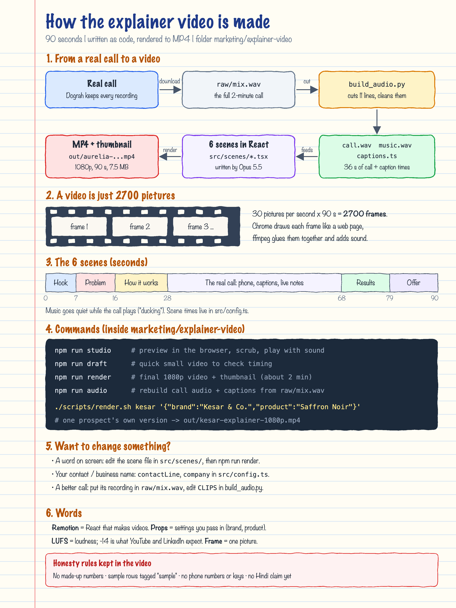

# Explainer video: how it was made

A 90-second motion-graphic video for client outreach, built on 11 Oct 2026. It is written as
code (React + [Remotion](https://www.remotion.dev)) and rendered to an MP4 on the Mac, using the
real recording of Meera's call from 10 Oct.



- Project and full instructions: [`marketing/explainer-video/README.md`](../../marketing/explainer-video/README.md)
- Final video: `marketing/explainer-video/out/aurelia-explainer-1080p.mp4`

## What was done, in order

1. **Made a Remotion project** in `marketing/explainer-video` (Node 20, ffmpeg and Chrome were already on the Mac).
2. **Got the real call from Dograh.** Every call run has a full recording, separate Meera and
   customer tracks, and a transcript. They were downloaded on the VM using the API key stored in
   n8n (never printed), then copied to the Mac into `raw/`.
3. **Cut the best 36 seconds.** ffmpeg's `silencedetect` gave the start and end of every spoken
   line. `scripts/build_audio.py` keeps 11 lines and drops filler ("No problem.") and the old
   "zero to ten" scale explanation, then cleans the sound and writes caption timings.
4. **Made music** with ffmpeg (four soft chords), so there is nothing to license.
5. **Designed the scenes.** An Opus 5.5 subagent drew style frames for all 6 scenes. They were
   reviewed as still images, then animated: parcel drop, arrows, cards, live waveform, captions,
   notes filling in, sheet rows, offer.
6. **Rendered and mastered**: `scripts/render.sh` renders 2700 frames, then sets loudness to -14 LUFS.
7. **Tested a personalised version** (another brand and product) with one command.

## Commands worth remembering

```bash
cd marketing/explainer-video
npm run studio                       # preview
npm run render                       # final video + thumbnail
./scripts/render.sh name '{"brand":"...","product":"..."}'   # prospect version
ffmpeg -i in.wav -af silencedetect=noise=-38dB:d=0.35 -f null -   # find where speech starts/stops
ffmpeg -i video.mp4 -af ebur128 -f null -                         # measure loudness (LUFS)
```

## Checks done

- `npx tsc --noEmit` passes. A half-size draft and the full 1080p render both last 90 s.
- Still frames checked for every scene, every scene change, moments inside speech (waveform
  moving) and the personalised version (long brand name fits on the phone).
- Loudness: about -15 LUFS overall. The call part is loud and clear, and the music bed is about 11 dB lower.

## Still to do (you)

- Listen once. The customer's first answer is captioned from the transcript, so correct it in
  `CLIPS` if the words differ.
- Put your contact (email or booking link) in `src/config.ts`, then run `npm run render`.
- Upload to YouTube (unlisted) or Loom and use the link in outreach messages.
- Optional: re-record the call after the rating-question change and swap the audio, so the
  customer answers with a higher score in a clearer voice.

## Words

| Word | Meaning |
|---|---|
| Remotion | A library that turns React components into video frames |
| Frame | One picture; 30 per second |
| Props | Settings passed in at render time (brand, product, contact) |
| Ducking | Music turns down while someone speaks |
| LUFS | A loudness unit; -14 is the YouTube / LinkedIn target |
| Style frame | One still image per scene, used to approve the look before animating |
