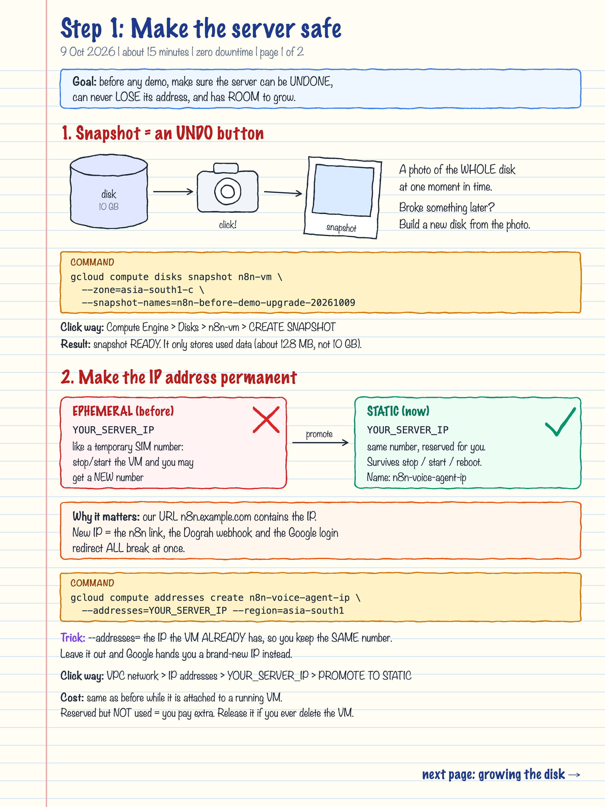
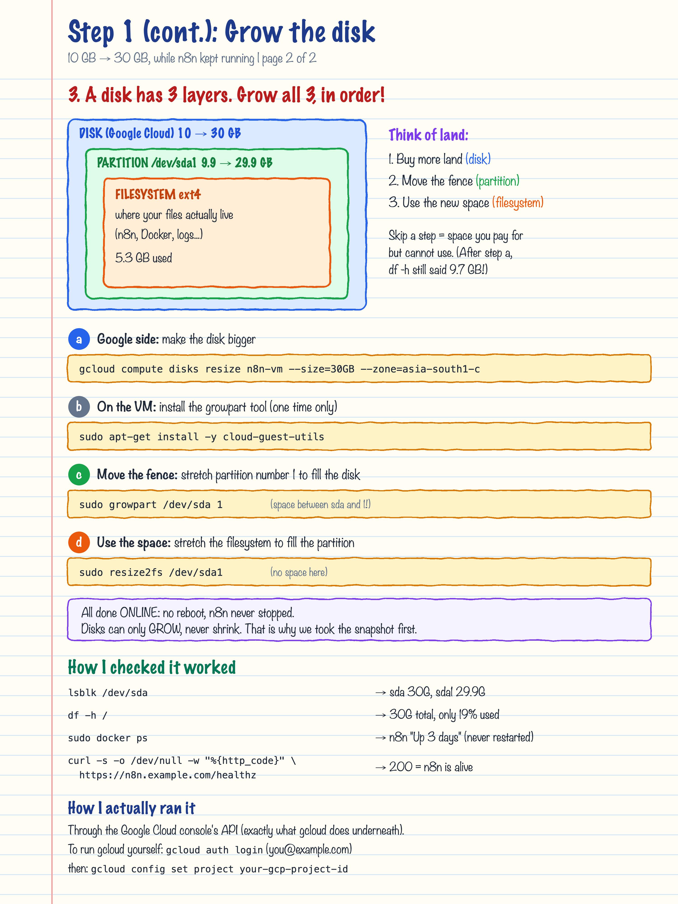
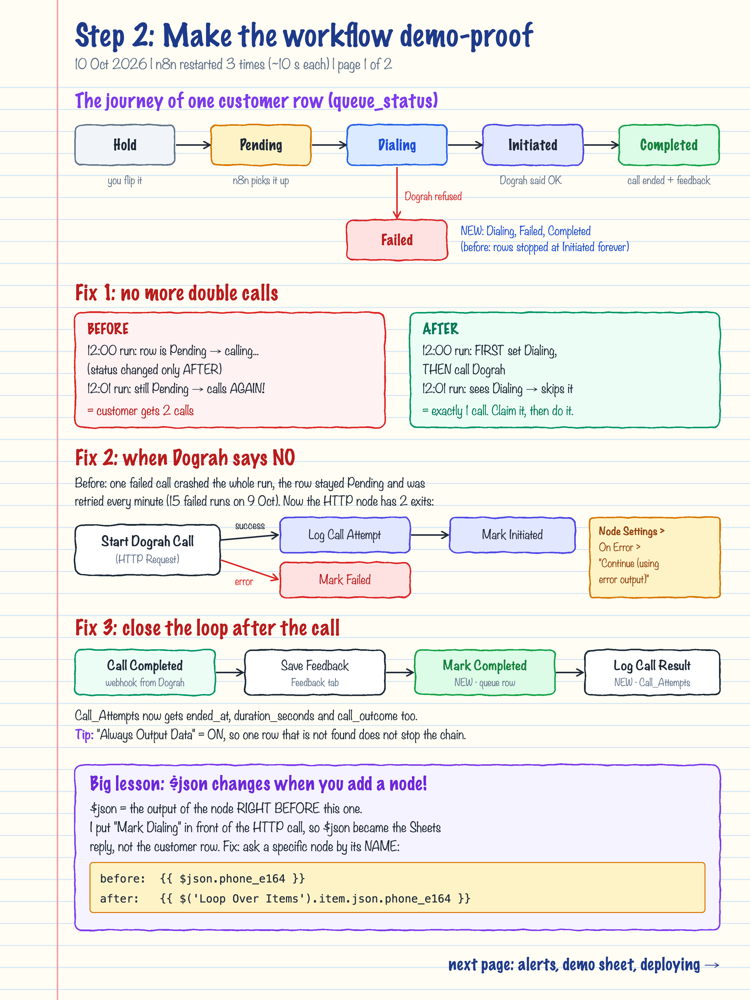
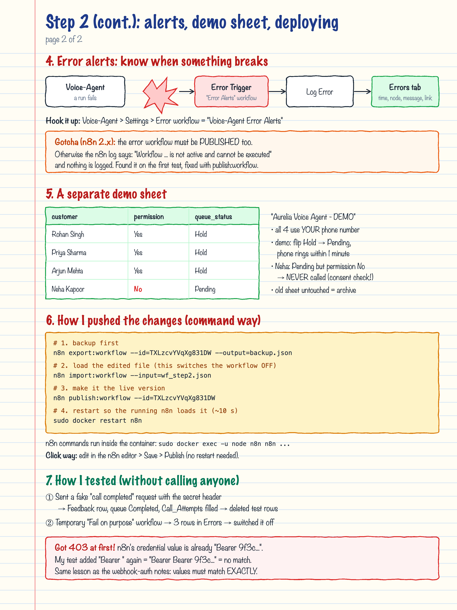
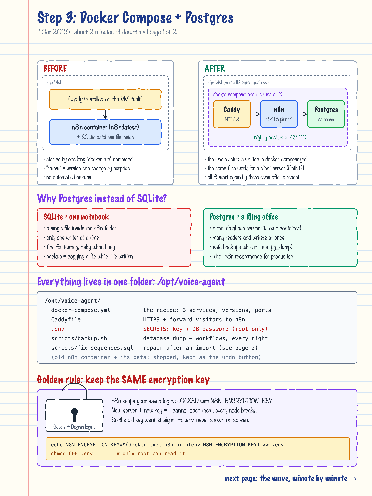
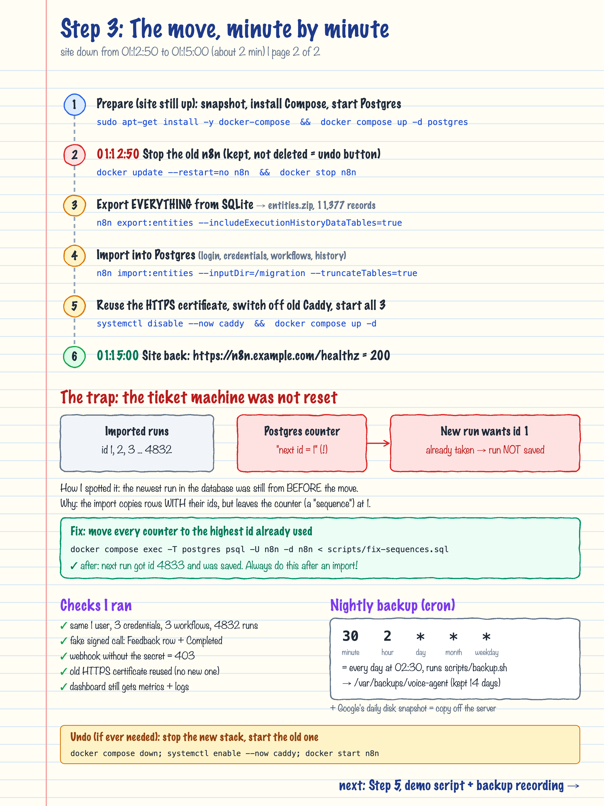
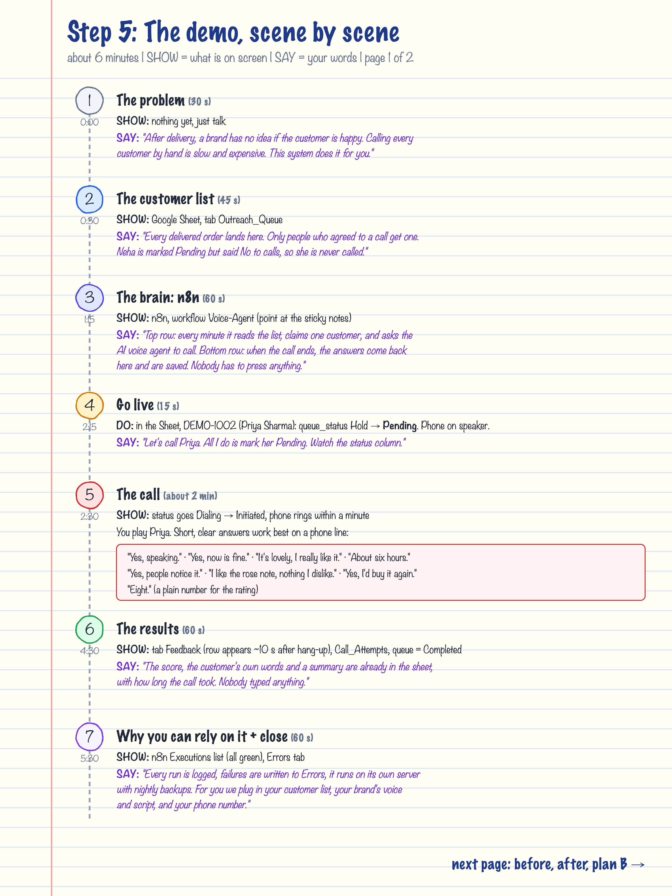
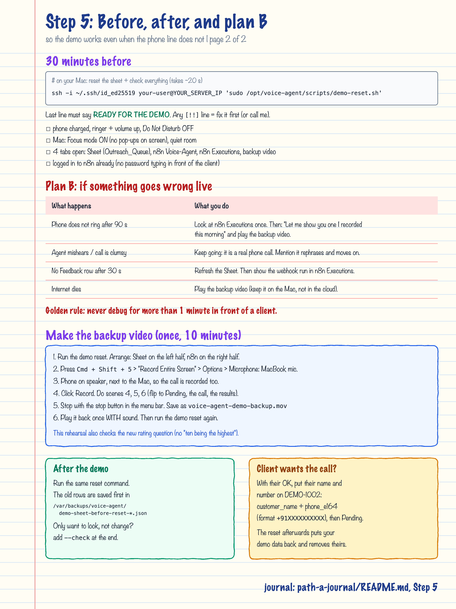

# Path A journal: making the demo server production-ready

A running log of every change made to the demo server (`n8n-vm`, `https://n8n.example.com`).
Each step has:

- **Hand-drawn note pages** in `notes/` (quick visual revision).
- **This file**: what was done, why, the exact commands, how it was checked, and how to undo it.

New steps are added at the bottom as they happen.

## Progress

| Step | What | Date | Status | Notes |
|---|---|---|---|---|
| 1 | Make the server safe: snapshot, static IP, bigger disk | 9 Oct 2026 | Done | [page 1](notes/step-1-page-1.png), [page 2](notes/step-1-page-2.png) |
| 2 | Workflow fixes for a reliable demo (Dialing, Completed, error alerts, demo sheet) | 10 Oct 2026 | Done (live call passed 11 Oct) | [page 1](notes/step-2-page-1.png), [page 2](notes/step-2-page-2.png) |
| 3 | Move to the deployment bundle (Docker Compose + Postgres + backups) | 11 Oct 2026 | Done | [page 1](notes/step-3-page-1.png), [page 2](notes/step-3-page-2.png) |
| 4 | Domain | | Skipped for now (keeping sslip.io) | |
| 5 | Demo script + backup recording | 11 Oct 2026 | Scripts + notes done; rehearsal + video pending (needs you) | [page 1](notes/step-5-page-1.png), [page 2](notes/step-5-page-2.png) |

## Before you run any command yourself

Commands marked **[Mac]** run in your Mac terminal with `gcloud`. Commands marked **[VM]** run on the server
after SSH-ing in.

```bash
# [Mac] one-time setup so gcloud talks to the right account and project
gcloud auth login                          # pick you@example.com
gcloud config set project your-gcp-project-id

# [Mac] SSH into the VM
ssh -i ~/.ssh/id_ed25519 your-user@YOUR_SERVER_IP
```

---

## Step 1: Make the server safe (9 Oct 2026, zero downtime)




### 1.1 Snapshot (the undo button)

**Why:** a snapshot is a photo of the whole disk. If any later step breaks the server, we can build a new disk
from it. It only stores used data (about 128 MB here), so it is cheap.

```bash
# [Mac]
gcloud compute disks snapshot n8n-vm \
  --zone=asia-south1-c \
  --snapshot-names=n8n-before-demo-upgrade-20261009
```

Click way: Compute Engine > Disks > n8n-vm > Create snapshot.

Check: `gcloud compute snapshots list` shows `n8n-before-demo-upgrade-20261009` with status `READY`.

Also good to know: the disk already had an automatic daily snapshot schedule (`default-schedule-1`).

### 1.2 Static IP (the permanent phone number)

**Why:** the VM had an *ephemeral* (temporary) IP. A stop/start can change it, and our URL
`n8n.example.com` contains the IP, so the n8n link, the Dograh webhook and the Google OAuth redirect
would all break. Promoting it to *static* keeps the same number forever.

```bash
# [Mac]  --addresses=<the IP the VM already has> keeps the SAME IP
gcloud compute addresses create n8n-voice-agent-ip \
  --addresses=YOUR_SERVER_IP --region=asia-south1
```

Click way: VPC network > IP addresses > YOUR_SERVER_IP > Promote to static IP address.

Check: `gcloud compute addresses list` shows `n8n-voice-agent-ip  YOUR_SERVER_IP  IN_USE`.

Cost: same as an ephemeral IP while attached to a running VM. A reserved IP that is not attached costs more,
so release it if the VM is ever deleted.

### 1.3 Grow the disk 10 GB -> 30 GB (three layers)

**Why:** the disk was 58% full. Docker images, logs and Postgres (Step 3) need room.

A disk has three layers and each must be grown, in this order:

| Layer | Analogy | Grown with |
|---|---|---|
| Disk (Google Cloud) | Buy more land | `gcloud compute disks resize` |
| Partition `/dev/sda1` | Move the fence | `growpart` |
| Filesystem (ext4) | Use the new space | `resize2fs` |

```bash
# [Mac] a) make the Google disk bigger (works while the VM runs)
gcloud compute disks resize n8n-vm --size=30GB --zone=asia-south1-c

# [VM]  b) install the growpart tool (one time only)
sudo apt-get install -y cloud-guest-utils

# [VM]  c) stretch partition number 1 to fill the disk   (note the space: "sda 1")
sudo growpart /dev/sda 1

# [VM]  d) stretch the filesystem to fill the partition   (no space: "sda1")
sudo resize2fs /dev/sda1
```

Disks can only grow, never shrink, which is why the snapshot came first.

### How Step 1 was checked

```bash
# [VM]
lsblk /dev/sda          # sda 30G, sda1 29.9G
df -h /                 # 30G total, 19% used (was 9.7G, 58%)
sudo docker ps          # n8n "Up 3 days": never restarted
curl -s -o /dev/null -w "%{http_code}\n" https://n8n.example.com/healthz   # 200
```

### How to undo Step 1 (only if ever needed)

```bash
# [Mac] give the IP back to "ephemeral" (the VM keeps it until its next stop)
gcloud compute addresses delete n8n-voice-agent-ip --region=asia-south1

# [Mac] restore the server from the snapshot: create a disk from it, then attach it as the boot disk
gcloud compute disks create n8n-restored --zone=asia-south1-c \
  --source-snapshot=n8n-before-demo-upgrade-20261009
```

The disk resize cannot be undone (disks never shrink), and does not need to be.

### How it was actually run

The Google Cloud steps were sent through the Google Cloud console's API (the same API `gcloud` calls),
because `gcloud` on the Mac is signed in to a different account. The VM steps were run over SSH.
The results are identical to running the commands above.

### Words learned in Step 1

- **Snapshot**: a point-in-time copy of a disk you can restore from.
- **Ephemeral IP**: a temporary public IP that can change when the VM stops.
- **Static IP**: a reserved public IP that stays yours until you release it.
- **Partition**: a section of a disk (`/dev/sda1` is partition 1 of disk `sda`).
- **Filesystem (ext4)**: the structure inside a partition that stores files and folders.
- **Online resize**: growing storage while the system keeps running, with no reboot.

---

## Step 2: Make the workflow demo-proof (10 Oct 2026)




Downtime: n8n was restarted 3 times, about 10 seconds each. No call was running at the time.

### What changed

| Change | Problem it solves |
|---|---|
| New node **Mark Dialing** before the Dograh call (also adds +1 to `attempt_count`) | A slow run could dial the same customer twice, because the row stayed `Pending` until after the call |
| **Start Dograh Call** (HTTP Request) now has an error exit to new node **Mark Failed** | One refused call crashed the whole run and the row was retried every minute (15 failed runs on 9 Oct) |
| **Mark Initiated** no longer touches `attempt_count` | It is counted once, in Mark Dialing |
| New nodes **Mark Completed** + **Log Call Result** after **Save Feedback** | Rows stopped at `Initiated` forever; Call_Attempts never got ended_at / duration / outcome |
| New workflow **Voice-Agent Error Alerts** (Error Trigger -> Errors tab), set as Voice-Agent's error workflow | Failures were silent |
| New spreadsheet **Aurelia Voice Agent - DEMO**, workflow now points to it | Demos used a sheet with friends' real numbers |
| Nodes renamed (Read Outreach Queue, Ready to Call?, Start Dograh Call, Log Call Attempt, Mark Initiated, Save Feedback) + 2 sticky notes | Readable when you show the workflow in a demo |

Status journey of a queue row: `Hold -> Pending -> Dialing -> Initiated -> Completed`, or `Dialing -> Failed`.

Demo sheet: https://docs.google.com/spreadsheets/d/YOUR_GOOGLE_SHEET_ID/edit
(tabs: Outreach_Queue, Call_Attempts, Feedback, Follow_Up_Tasks, Errors, Demo_Guide). The old sheet
`1k2GwIT7...` was not changed and is now an archive.

### Settings used (click way, if you build this by hand)

- **Mark Dialing**: Google Sheets > Update row > Outreach_Queue, match on `order_id`,
  `queue_status` = `Dialing`, `attempt_count` = `{{ Number($('Loop Over Items').item.json.attempt_count || 0) + 1 }}`.
- **Start Dograh Call**: Settings tab > On Error > *Continue (using error output)*. The node gets a second (red) exit.
- Body of Start Dograh Call uses `{{ $('Loop Over Items').item.json.phone_e164 }}` instead of `{{ $json.phone_e164 }}`,
  because the node in front of it is now Mark Dialing.
- **Mark Completed** / **Log Call Result**: Settings tab > *Always Output Data* = on.
- **Voice-Agent** > workflow Settings > *Error workflow* = Voice-Agent Error Alerts.

### Commands run

```bash
# [VM] 1. backup (also saved in learning/path-a-journal/backups/Voice-Agent-before-step-2.json)
sudo docker exec -u node n8n n8n export:workflow --id=TXLzcvYVqXg831DW --output=/tmp/backup.json

# [Mac] 2. built the new workflow JSON with a small Python script (edits listed above)

# [VM] 3. copy into the container and import (import switches the workflow OFF)
sudo docker cp /tmp/wf_step2.json n8n:/tmp/wf_step2.json
sudo docker exec -u node n8n n8n import:workflow --input=/tmp/wf_step2.json

# [VM] 4. make both workflows the live (published) version
sudo docker exec -u node n8n n8n publish:workflow --id=TXLzcvYVqXg831DW
sudo docker exec -u node n8n n8n publish:workflow --id=vaErrorAlerts001

# [VM] 5. restart so the running n8n loads the published versions
sudo docker restart n8n
```

The demo spreadsheet was created with the Google Sheets API, using n8n's existing Google credential
(its `spreadsheets` permission allows creating new sheets). Tab IDs were kept identical to the old sheet, so
the workflow only needed the new spreadsheet ID.

### How Step 2 was checked

| Check | Result |
|---|---|
| Live version = new version (`activeVersionId` = `versionId`) | Yes |
| Scheduled runs after the change | Every minute, success, reading the demo sheet; nothing dialed (all rows Hold, Neha has no permission) |
| Fake signed "call completed" request | 200; Feedback row written, queue row `Completed`, Call_Attempts got ended_at / 42 s / end_call |
| Temporary "Fail on purpose" workflow | 3 failures -> 3 rows in Errors with node, message and execution link |
| Webhook without the secret | 403 (still protected) |
| Cleanup | Test rows deleted, DEMO-1003 back to Hold, test workflow unpublished (its URL now returns 404) |

**Still to do: one real call** (needs your phone). In the demo sheet set `DEMO-1001` to `Pending`, answer,
give feedback, hang up. Watch the row go Pending -> Dialing -> Initiated -> Completed.

### Problems hit (and what they teach)

- **Error workflow did nothing at first.** n8n log: `Workflow "vaErrorAlerts001" is not active and cannot be executed`.
  In n8n 2.x an error workflow must be published. Older tutorials say it does not.
- **Test webhook got 403.** n8n's Header Auth value already contains `Bearer <token>`; the test added another
  `Bearer `. Values must match exactly.
- **404 right after restart.** Webhooks register a few seconds after `/healthz` turns 200. Wait ~10 s before testing.
- **Startup warning:** `WEBHOOK_URL` is deprecated in favour of `N8N_WEBHOOK_URL`. Fixed in Step 3.

### How to undo Step 2

```bash
# [Mac] copy the backup to the VM, then on the VM:
sudo docker cp Voice-Agent-before-step-2.json n8n:/tmp/old.json
sudo docker exec -u node n8n n8n import:workflow --input=/tmp/old.json
sudo docker exec -u node n8n n8n publish:workflow --id=TXLzcvYVqXg831DW
sudo docker restart n8n
```

Since Step 3, run these from `/opt/voice-agent` with `sudo docker compose cp` / `sudo docker compose exec -u node n8n`
instead of `docker cp` / `docker exec n8n`, and `sudo docker compose restart n8n` instead of `docker restart n8n`.

This also points the workflow back to the old sheet. The demo spreadsheet and the Error Alerts workflow can
stay; they do nothing on their own.

### Words learned in Step 2

- **Claim before you work**: mark a job as taken (Dialing) before doing it, so a second worker skips it.
- **Error output**: a second exit on a node that receives the items that failed, instead of stopping the run.
- **Always Output Data**: a node passes an (empty) item on even when it found nothing, so the chain continues.
- **`$json` vs `$('Node').item.json`**: the previous node's output vs a named node's output for the same item.
- **Error workflow / Error Trigger**: a workflow that n8n runs automatically when another workflow fails.
- **Import / publish**: import loads a workflow definition; publish makes that version the one that runs.

---

## Step 3: Docker Compose + Postgres + backups (11 Oct 2026)




Downtime: about 2 minutes (01:12:50 to 01:15:00 IST). No call was running; all queue rows were on Hold.

### What changed

| Before | After |
|---|---|
| One n8n container started by a long `docker run` command, image `n8n:latest` | Three containers described in `/opt/voice-agent/docker-compose.yml`, n8n pinned to `2.41.6` |
| SQLite file inside the n8n volume | Postgres 16 in its own container (volume `voice-agent_postgres_data`) |
| Caddy installed directly on the VM (`/etc/caddy/Caddyfile`) | Caddy container (`caddy:2`), same certificate reused |
| No backups apart from disk snapshots | `scripts/backup.sh` every night at 02:30, kept 14 days in `/var/backups/voice-agent` |
| `WEBHOOK_URL` (deprecated warning at startup) | `N8N_WEBHOOK_URL` |

Everything moved across with the database: your n8n login, the 3 credentials, both published workflows,
the error-workflow setting and all 4,832 past runs. Nothing had to be set up again in the n8n editor or in Dograh,
because the address (`https://n8n.example.com`) and the webhook secret did not change.

### Commands run

```bash
# [Mac] 1. restore point (done through the Cloud Console API; same as this gcloud command)
gcloud compute disks snapshot n8n-vm --zone=asia-south1-c --snapshot-names=n8n-before-step-3-20261011

# [VM] 2. install Docker Compose v2 (Debian package)
sudo apt-get install -y docker-compose
docker compose version                         # Docker Compose version 2.26.1

# [Mac] 3. copy the deploy bundle to the VM, then unpack it in /opt/voice-agent
tar czf /tmp/bundle.tgz -C deploy docker-compose.yml Caddyfile .env.example scripts workflows README.md
scp /tmp/bundle.tgz your-user@YOUR_SERVER_IP:/tmp/

# [VM] 4. secrets file: the OLD encryption key goes straight in, never printed
sudo sh -c 'umask 077; {
  echo DOMAIN=n8n.example.com
  echo ACME_EMAIL=you@example.com
  echo N8N_VERSION=2.41.6
  echo N8N_ENCRYPTION_KEY=$(docker exec n8n printenv N8N_ENCRYPTION_KEY)
  echo DB_PASSWORD=$(openssl rand -hex 32)
  echo TIMEZONE=Asia/Kolkata
} > /opt/voice-agent/.env'

# [VM] 5. download images and start only Postgres (site still up)
cd /opt/voice-agent
sudo docker compose pull
sudo docker compose up -d postgres

# ---- downtime starts ----
# [VM] 6. stop the old n8n, keep it for undo
sudo docker update --restart=no n8n && sudo docker stop n8n

# [VM] 7. export everything with a one-off container on the old data volume
sudo docker run --rm --env-file .env --volumes-from n8n docker.n8n.io/n8nio/n8n:2.41.6 \
  export:entities --outputDir=/home/node/.n8n/migration --includeExecutionHistoryDataTables=true

# [VM] 8. let n8n create empty tables in Postgres, stop it, then import
sudo docker compose up -d n8n          # wait for healthz 200
sudo docker compose stop n8n
sudo mkdir -p /var/tmp/n8n-import
sudo cp /var/lib/docker/volumes/n8n_data/_data/migration/entities.zip /var/tmp/n8n-import/
sudo chown -R 1000:1000 /var/tmp/n8n-import
sudo docker compose run --rm --no-deps -v /var/tmp/n8n-import:/migration n8n \
  import:entities --inputDir=/migration --truncateTables=true

# [VM] 9. reuse the old certificate, retire the host Caddy, start all 3
sudo docker compose create caddy
sudo mkdir -p /var/lib/docker/volumes/voice-agent_caddy_data/_data/caddy
sudo cp -a /var/lib/caddy/.local/share/caddy/. /var/lib/docker/volumes/voice-agent_caddy_data/_data/caddy/
sudo systemctl disable --now caddy
sudo docker compose up -d
# ---- downtime ends ----

# [VM] 10. fix the Postgres id counters (see "Problems hit"), then restart n8n
sudo docker compose exec -T postgres psql -U n8n -d n8n < scripts/fix-sequences.sql
sudo docker compose restart n8n

# [VM] 11. Ops Agent: Caddy now logs to Docker, so remove the caddy_log receiver
sudo cp /etc/google-cloud-ops-agent/config.yaml /etc/google-cloud-ops-agent/config.yaml.before-step3
#   (deleted the caddy_log receiver and its pipeline from config.yaml)
sudo systemctl restart google-cloud-ops-agent

# [VM] 12. first backup by hand, then every night at 02:30
sudo /opt/voice-agent/scripts/backup.sh
echo "30 2 * * * root /opt/voice-agent/scripts/backup.sh >> /var/log/voice-agent-backup.log 2>&1" \
  | sudo tee /etc/cron.d/voice-agent-backup
```

### Everyday commands from now on

```bash
cd /opt/voice-agent
sudo docker compose ps                      # are all 3 running / healthy?
sudo docker compose logs --tail 100 n8n     # n8n log
sudo docker compose logs --tail 50 caddy    # HTTPS / visitor log
sudo docker compose restart n8n             # restart only n8n
sudo ./scripts/backup.sh                    # backup now
sudo ls -la /var/backups/voice-agent        # list backups
```

Old habits that no longer work: `docker exec n8n ...` now targets the stopped old container. Use
`sudo docker compose exec -u node n8n n8n ...` from `/opt/voice-agent` instead.

### How Step 3 was checked

| Check | Result |
|---|---|
| Row counts in Postgres vs old SQLite | Same: 1 user, 3 credentials, 3 workflows, 4,832 runs; both workflows active + published |
| `https://n8n.example.com/healthz` | 200 |
| HTTPS certificate | Same Let's Encrypt certificate as before (issued 4 Oct, valid to 2 Jan 2027) |
| Webhook without the secret | 403 |
| `/metrics` from the internet | 404 (hidden); still readable on `127.0.0.1:5678` for the dashboard |
| Scheduled runs | Every minute, success, stored in Postgres (first new run: id 4833) |
| Fake signed "call completed" request | 200; Feedback row, queue row `Completed`, Call_Attempts updated. Proves the encryption key, the Google login and the webhook secret all moved correctly. Test rows deleted afterwards |
| Backup | 1.6 MB database dump (142 tables) + workflow JSON in `/var/backups/voice-agent` |
| After a reboot | Docker starts at boot; all 3 containers have `restart: unless-stopped`; old container and host Caddy will stay off |

### Problems hit (and what they teach)

- **Import failed with `EROFS: read-only file system`.** I mounted the export folder read-only to protect it, but
  `import:entities` unpacks `entities.zip` next to itself. Fix: copy the zip to a scratch folder that n8n may write to.
- **New runs were not saved after the move (the big one).** The newest run in the database was still from before
  the move. The import copies every row with its original id, but Postgres keeps a separate counter (a *sequence*)
  for the next id, and that counter stayed at 1. Each new run tried id 1, which was already taken. Fix:
  `scripts/fix-sequences.sql` moves every counter to the highest id in its table. About 2 minutes of scheduled runs
  were lost; they only read the sheet (all rows on Hold), so nothing was missed. Always run it after `import:entities`.
- **`docker exec n8n ...` returned nothing for the credential export.** The live container is now called
  `voice-agent-n8n-1`; the old name points at the stopped container.

### How to undo Step 3

```bash
# [VM] stop the new stack, bring back the old container and host Caddy (old data was never touched)
cd /opt/voice-agent && sudo docker compose down
sudo systemctl enable --now caddy
sudo docker update --restart=unless-stopped n8n && sudo docker start n8n
# optional: put the old Ops Agent config back
sudo cp /etc/google-cloud-ops-agent/config.yaml.before-step3 /etc/google-cloud-ops-agent/config.yaml
sudo systemctl restart google-cloud-ops-agent
```

Anything that happened after the move (new calls, feedback) lives only in Postgres and would not be in the old
SQLite. Last resort: restore the disk from snapshot `n8n-before-step-3-20261011`.

Once the new stack has run well for about a week, the old pieces can be removed:
`sudo docker rm n8n`, `sudo docker volume rm n8n_data`, `sudo apt-get remove caddy`.

### Words learned in Step 3

- **Docker Compose**: one YAML file that describes several containers, their settings and how they connect.
  `docker compose up -d` starts them all; `down` stops and removes them (the data volumes stay).
- **Pinned version**: `n8n:2.41.6` instead of `n8n:latest`, so an update only happens when you choose.
- **Postgres vs SQLite**: a database server in its own container vs a single file inside the app.
- **`export:entities` / `import:entities`**: n8n commands that copy the whole database between database types.
- **Sequence**: Postgres's "next id" counter for a table. It must be moved forward after copying rows in with ids.
- **`.env` file**: holds the secrets that `docker-compose.yml` reads. `chmod 600` = only the owner (root) can read it.
- **Volume**: Docker's storage that survives when a container is deleted (`voice-agent_postgres_data` etc.).
- **cron**: Linux's timer. `30 2 * * *` = minute 30, hour 2, every day, every month, every weekday.
- **Cutover**: the short moment when traffic switches from the old system to the new one.

---

## Real call test + Dograh prompt fixes (11 Oct 2026)

First real call on the new stack (01:26): n8n worked end to end (Pending -> Dialing -> Initiated -> Completed,
Feedback row, Call_Attempts with 66 s / user_hangup). But Meera kept asking "what has your overall experience been
like?" again and again.

**Cause (not the deployment):** the call used the same Dograh agent version as the good 9 Oct calls, and n8n sent
the same details. The phone line misheard the answers ("It's thirty nine", "if I was ready for ten") and the
Feedback Conversation prompt had no rule for unclear answers, so the AI re-asked forever. On 9 Oct the answers were
clear ("It was great"), so the gap never showed.

**How it was found:** Dograh's API returns every call turn by turn (bot text, what the user was heard saying, node
changes): `GET https://api.dograh.com/api/v1/workflow/12967/runs/<run id>` with the `X-API-Key` header.
Comparing a bad call with a good one showed the difference in seconds.

**Fixes made in Dograh (Feedback Conversation node), then Publish:**

| Change | Why |
|---|---|
| "How to handle answers" block: accept short/vague opinions, rephrase once if it sounds like nonsense, ask at most twice, never a third time | Stops the loop |
| `nps` extraction prompt replaced (it contained the follow-up text by copy-paste mistake); that text moved to `follow_up` | Score was being extracted with the wrong instructions |
| Rating question given word for word, "do not explain what zero or ten mean" | The AI added "with ten being the highest" by itself |

**Re-test (01:39):** misheard answers were rephrased once, then she moved on ("No problem."). All 6 questions,
End Call, NPS 5 saved, n8n webhook run success. This call was made before the rating-question change, so it still
explained the scale; that change is checked on the next call.

### Words learned

- **STT (speech-to-text)**: turns the caller's voice into text. It makes mistakes, so prompts must expect garbage.
- **Retry limit**: "ask at most twice" - the voice-agent version of a loop guard.
- **Extraction variables**: values Dograh pulls out of the conversation (nps, quote...) and sends to n8n.
- **Definition id / version**: each Publish in Dograh creates a new version; the run shows which one was used.

---

## Step 5: Demo-ready (11 Oct 2026)




No downtime. Backups got their own lesson: [../backups/README.md](../backups/README.md).

### What was added

| File (in `/opt/voice-agent/scripts/` and `deploy/scripts/`) | What it does |
|---|---|
| `demo-reset.sh` + `demo_reset.py` | Saves the demo sheet to a backup file, empties Call_Attempts / Feedback / Follow_Up_Tasks / Errors (headers kept), puts the 4 demo rows back (all Hold, Neha Pending with permission No), then runs the pre-flight checks |
| `demo-reset.sh --check` | Only the checks, changes nothing |
| `restore-test.sh` | Restore drill: loads a backup into a throwaway Postgres and compares counts with the live database |

Pre-flight checks: the 3 containers healthy, `https://.../healthz` = 200, disk below 80 %, a backup from the last
26 h, both workflows active + published, the last 5 runs successful, the webhook rejects unsigned requests (403),
the Google login works, the Dograh agent is published. It ends with `READY FOR THE DEMO` or `NOT READY`.

### Commands

```bash
# [Mac] before (and after) every demo
ssh -i ~/.ssh/id_ed25519 your-user@YOUR_SERVER_IP 'sudo /opt/voice-agent/scripts/demo-reset.sh'

# [Mac] only check, change nothing
ssh -i ~/.ssh/id_ed25519 your-user@YOUR_SERVER_IP 'sudo /opt/voice-agent/scripts/demo-reset.sh --check'

# [VM] restore drill (monthly)
cd /opt/voice-agent && sudo ./scripts/restore-test.sh
```

How the scripts get Google and Dograh access without storing secrets: they ask n8n to export its own credentials
into a temporary file inside the container, pipe it straight into Python, and delete the file when done
(even on errors, thanks to `trap ... EXIT`). Nothing secret is printed or written to the host disk.

### How Step 5 was checked

| Check | Result |
|---|---|
| `demo-reset.sh --check` | All `[OK]`, Dograh agent version 10 published |
| `demo-reset.sh` | Saved `demo-sheet-before-reset-20261011-021425.json`, removed 2 test rows each from Call_Attempts and Feedback, DEMO-1001 back to Hold |
| `restore-test.sh` on the 01:18 backup | Restored in 8 s; users 1/1, credentials 3/3, workflows 3/3, published 2/2 |

### Still to do (needs you, about 10 minutes)

1. **Rehearsal call** following page 1 (use DEMO-1002, Priya). Also confirms the rating question no longer explains the scale.
2. **Backup video** while rehearsing (page 2, "Make the backup video"). Keep it on the Mac.
3. Run the reset again afterwards.

### Words learned in Step 5

- **Pre-flight check**: a checklist run before take-off; here, before a demo.
- **Idempotent**: running the reset twice gives the same result as running it once. Safe to run any time.
- **`trap ... EXIT`**: a bash line that runs a clean-up command when the script ends, even after an error.
- **Plan B**: the backup video, so a bad phone line never ruins a demo.
