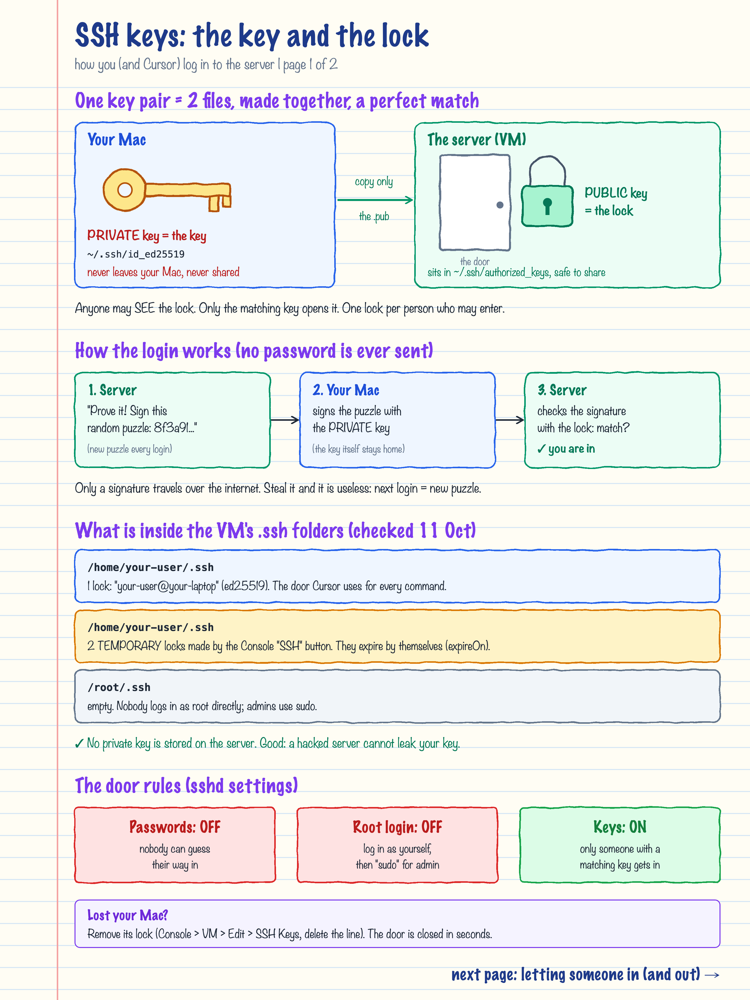
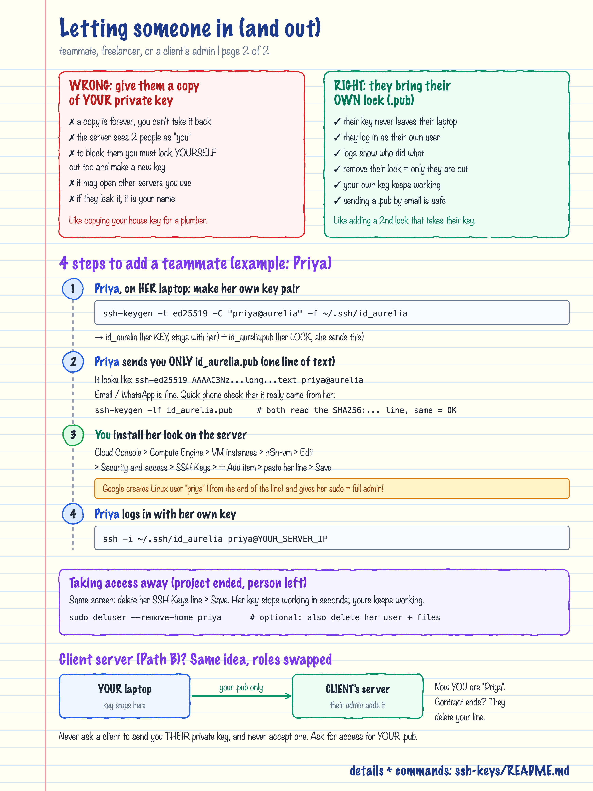

# SSH keys: how you log in to the server, and how to let others in

Checked on the demo VM `n8n-vm` (YOUR_SERVER_IP) on 11 Oct 2026.

## TL;DR

- An SSH key is a **pair of files**: a **private key** (the key, stays on your laptop) and a **public key**
  `.pub` (the lock, goes on the server). They are made together and only fit each other.
- The server's `~/.ssh/authorized_keys` file is a list of locks. Anyone whose key fits one of them may log in.
- The VM stores **no private keys**, only locks. Passwords and root login are switched off.
- To give someone access: they make **their own** key pair and send you **only their `.pub`**. You add it.
  To remove them, delete that one line. Never hand out your private key.




---

## 1. The key pair

| File | Example | Analogy | Who may see it |
|---|---|---|---|
| Private key | `~/.ssh/id_ed25519` (on your Mac) | The physical key | Only you. Never email, paste, or upload it |
| Public key | `~/.ssh/id_ed25519.pub` | A lock that only that key opens | Anyone. It is safe to send |

A public key is one line of text:

```text
ssh-ed25519 AAAAC3NzaC1lZDI1NTE5AAAAI...  your-user@your-laptop
^ type       ^ the lock itself (long)       ^ comment: a label for humans
```

`ed25519` is the modern key type (short, fast, secure). Older ones you will meet: `rsa` and `ecdsa`.

## 2. How a login works (why no password is sent)

1. The server picks a random puzzle and says "sign this".
2. Your Mac signs it with the **private key**. The key itself never leaves the Mac.
3. The server checks the signature with the **public key** (the lock). If it matches, you are in.

Every login gets a new puzzle, so a recorded signature is useless to an attacker.

## 3. What is in the VM's `.ssh` folders

| Folder | Contents | Meaning |
|---|---|---|
| `/home/your-user/.ssh` | `authorized_keys`: 1 lock, `ssh-ed25519 ... your-user@your-laptop` | The key created on your Mac on 4 Oct. Cursor uses it for every server command |
| `/home/your-user/.ssh` | `authorized_keys`: 2 locks (ECDSA + RSA) with `google-ssh {"userName":"you@example.com","expireOn":"..."}` | Made automatically when you click **SSH** in the Cloud Console. They expire by themselves; new ones appear next time |
| `/root/.ssh` | empty | Nobody logs in directly as root |

Lines starting with `# Added by Google` are labels. Google's guest software on the VM rewrites these files from the
SSH keys stored in the VM's settings (metadata), so **manage keys in the Console, not by editing the file**:
a hand edit can be overwritten.

Folder rules SSH insists on: `.ssh` = `drwx------` (700), `authorized_keys` = `-rw-------` (600), owned by
the user. If permissions are looser, SSH ignores the file and the login fails.

## 4. The door rules on this server

From `sudo sshd -T`:

| Setting | Value | Meaning |
|---|---|---|
| `passwordauthentication` | `no` | Passwords cannot be used, so guessing is pointless |
| `permitrootlogin` | `no` | Log in as a normal user, then use `sudo` for admin work |
| `pubkeyauthentication` | `yes` | Keys are the only way in |
| `authorizedkeysfile` | `.ssh/authorized_keys` | Where each user's locks are read from |

Both `your-user` and `your-user` are in the `google-sudoers` group, so both can run `sudo` (full admin).

---

## 5. Letting someone else in

### Why you never share your private key

Giving someone a copy of your private key is like copying your house key for a plumber:

- **A copy is forever.** You cannot take a file back. Deleting it on their side is a promise, not a guarantee.
- **The server cannot tell you apart.** Both of you log in as `your-user`; if something breaks, the logs show "you".
- **Removing them removes you.** The only way to block them is to delete your own lock and make a new key pair,
  then re-install it everywhere it is used.
- **It may open other doors.** The same key might be on other servers or GitHub.
- **If they leak it, it is your name on it.**

The right way: **every person has their own key pair and you add their lock (`.pub`)**. Their private key never
leaves their laptop, they get their own Linux user, and you can remove exactly one person at any time.

### Step by step (example: teammate Priya)

**1. Priya makes her own key pair, on her laptop** (Mac, Linux, or Windows PowerShell):

```bash
ssh-keygen -t ed25519 -C "priya@aurelia" -f ~/.ssh/id_aurelia
```

It asks for a passphrase (recommended: a password that protects the key file if her laptop is stolen).
Result: `~/.ssh/id_aurelia` (her private key, stays with her) and `~/.ssh/id_aurelia.pub` (her lock).

**2. Priya sends you only the `.pub` file** (or pastes its one line). Email or WhatsApp is fine, it is a lock.
To be sure the line was not swapped on the way, both of you run this and read the `SHA256:...` part over the phone:

```bash
ssh-keygen -lf id_aurelia.pub
# 256 SHA256:abc123...xyz priya@aurelia (ED25519)
```

**3. You install her lock on the VM** (Cloud Console, recommended):

Compute Engine -> VM instances -> `n8n-vm` -> **Edit** -> *Security and access* -> **SSH Keys**
-> **+ Add item** -> paste her whole line -> **Save** (at the bottom).

Within seconds Google's guest software creates a Linux user named after the comment (`priya`), puts her line in
`/home/priya/.ssh/authorized_keys`, and adds her to `google-sudoers`.

> **Important:** a key added this way gets **sudo = full admin**: she could read `/opt/voice-agent/.env`
> (including the encryption key), stop n8n, or change anything. Only add people you trust with the whole server.
> For limited access, use the manual method below.

**4. Priya logs in with her own key:**

```bash
ssh -i ~/.ssh/id_aurelia priya@YOUR_SERVER_IP
```

### Limited access (no sudo): add the user by hand

For someone who should only look at logs, for example:

```bash
# [VM] create a normal user without a password, then install the lock
sudo adduser --disabled-password --gecos "" priya
sudo install -d -m 700 -o priya -g priya /home/priya/.ssh
echo 'ssh-ed25519 AAAA...her line... priya@aurelia' | sudo tee /home/priya/.ssh/authorized_keys >/dev/null
sudo chown priya:priya /home/priya/.ssh/authorized_keys && sudo chmod 600 /home/priya/.ssh/authorized_keys
```

She can log in but cannot use `sudo` or Docker, and cannot read `/opt/voice-agent/.env` (root only).
To let her read container logs, you would add her to the `docker` group, but note that the `docker` group is
effectively admin too.

### Taking access away

- Added in the Console: open the same **SSH Keys** list, delete her line, **Save**. Her key stops working within
  seconds; yours keeps working.
- Added by hand: `sudo rm /home/priya/.ssh/authorized_keys`.
- Optionally remove the user and her files: `sudo deluser --remove-home priya`.

### For teams later: OS Login

Google Cloud can also tie SSH access to Google accounts instead of keys (**OS Login**): you give someone's Google
account the IAM role *Compute OS Login* (normal user) or *Compute OS Admin Login* (sudo), and they connect with
`gcloud compute ssh`. Leaving the team = remove the role. Worth switching to once more than 2-3 people need access.
Note: once OS Login is turned on, the SSH Keys list above stops being used, so plan the switch.

### Client server (Path B): the same, with roles swapped

On a client's server **you** are "Priya": send the client's admin **your** `.pub` and ask them to add it. When the
contract ends, they delete your line and you are out, without anyone changing their own keys.
Never ask a client for their private key, and never accept one if offered.

---

## 6. Cheat sheet

```bash
# [Mac] list your keys
ls -la ~/.ssh

# [Mac] make a new key pair (one per purpose or per client is fine)
ssh-keygen -t ed25519 -C "rohan@aurelia" -f ~/.ssh/id_aurelia_client1

# [Mac] show a public key to send to someone
cat ~/.ssh/id_aurelia_client1.pub

# [any] fingerprint of a key (to compare over the phone)
ssh-keygen -lf ~/.ssh/id_aurelia_client1.pub

# [Mac] log in to this project's VM
ssh -i ~/.ssh/id_ed25519 your-user@YOUR_SERVER_IP

# [VM] who can log in as me?
cat ~/.ssh/authorized_keys

# [VM] which users have home folders / are admins?
ls /home ; getent group google-sudoers
```

Optional shortcut on your Mac, `~/.ssh/config`:

```text
Host n8n-demo
  HostName YOUR_SERVER_IP
  User your-user
  IdentityFile ~/.ssh/id_ed25519
```

Then `ssh n8n-demo` is enough.

## 7. Checklist for next time

- [ ] Each person has their own key pair; nobody shares a private key.
- [ ] Only `.pub` files are ever sent; the fingerprint is checked by phone for new people.
- [ ] Console-added keys = sudo. Use a hand-made user for limited access.
- [ ] Remove people the day they stop needing access.
- [ ] Lost laptop: remove its lock first, then make a new key pair.
- [ ] Private key files on your Mac stay `chmod 600` (SSH refuses keys that others can read).

## Words

- **SSH**: Secure Shell, the encrypted way to run commands on a remote computer.
- **Key pair**: a private key + public key made together.
- **`authorized_keys`**: the list of public keys (locks) allowed to log in as that user.
- **Fingerprint**: a short `SHA256:...` summary of a key, for comparing keys by eye or phone.
- **Passphrase**: an optional password that protects the private key file itself.
- **sudo**: "do this as admin". Members of `google-sudoers` may use it.
- **Metadata (SSH Keys)**: the VM settings where Google stores the locks it installs on the server.
- **OS Login**: Google Cloud feature that uses Google accounts + IAM roles instead of key lists.
