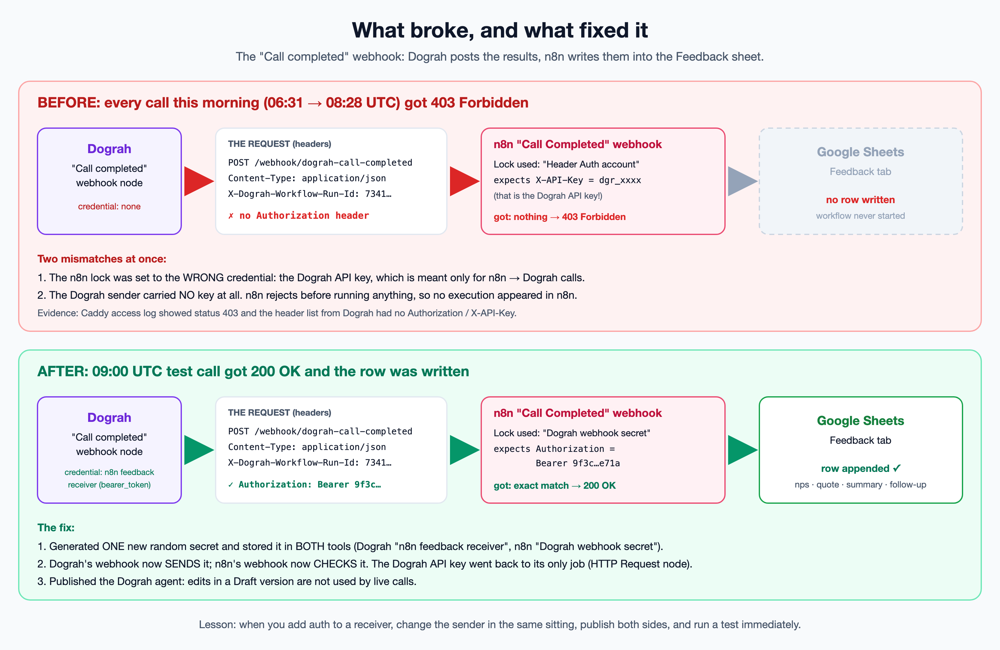
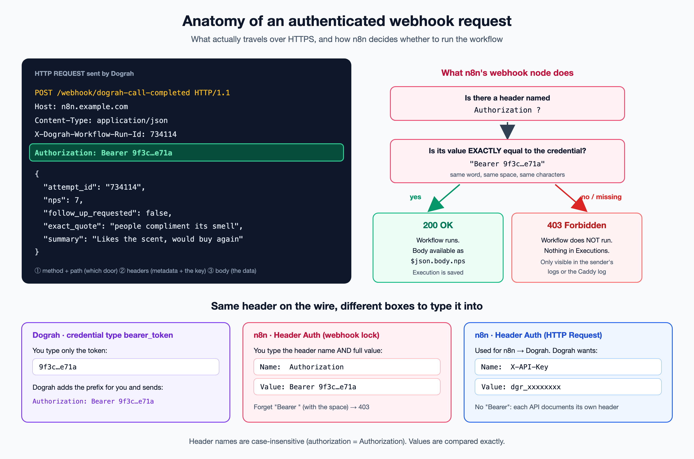
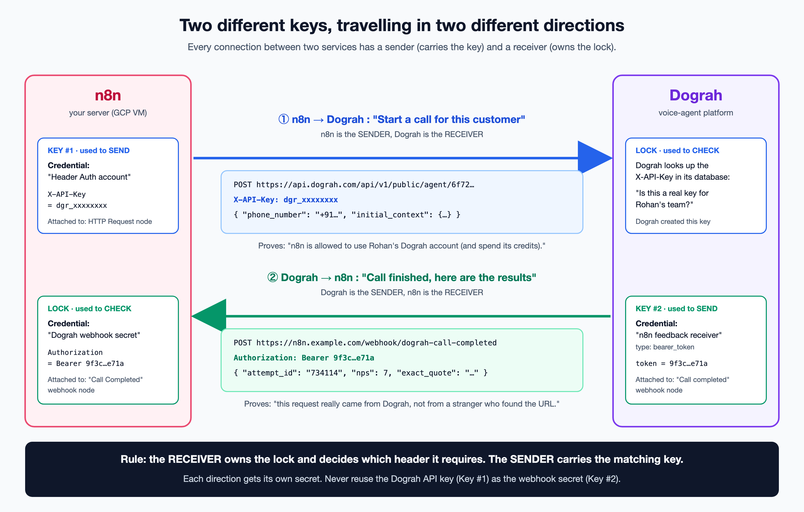
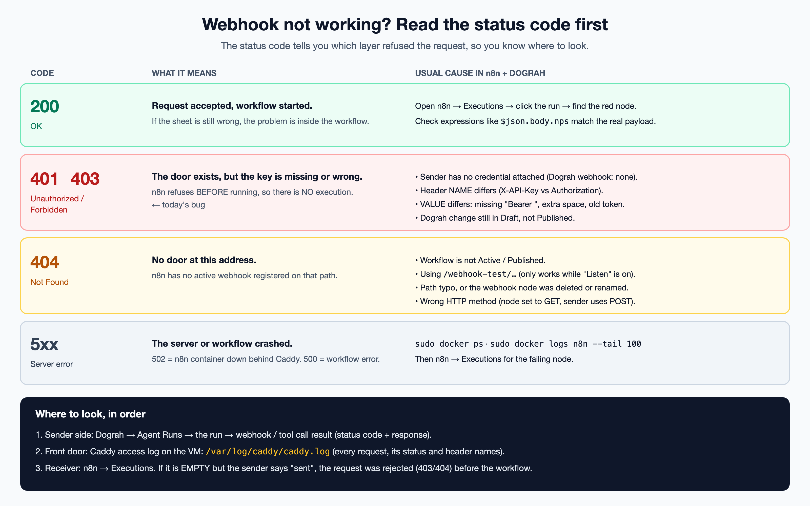

# Webhook authentication: what broke, and the concepts behind it

Incident date: 9 Oct 2026. Project: n8n + Dograh voice agent (Aurelia Perfumes feedback calls).

## TL;DR

After the call ended, Dograh sent the results (nps, quote, summary, follow-up) to n8n's
"Call Completed" webhook. n8n answered **403 Forbidden** and never ran the workflow, so no row
reached the Feedback sheet.

Two things were mismatched at the same time:

1. The n8n webhook was locked with the **wrong credential**: "Header Auth account", which holds the
   **Dograh API key** (`X-API-Key: dgr_...`). That key is only meant for n8n calling Dograh.
2. Dograh's "Call completed" webhook was sending **no key at all**.

Fix: one new random secret, stored on both sides. Dograh sends it as `Authorization: Bearer <secret>`,
n8n checks for exactly that value. Then Dograh was published, because Draft edits are not live.
The next call got **200 OK** and the row was written.



---

## 1. Every integration is "someone sends an HTTP request to someone else"

An HTTP request has 4 parts:

| Part | Example from this project | Purpose |
|---|---|---|
| Method | `POST` | What kind of action (GET = read, POST = send data) |
| URL / path | `https://n8n.example.com/webhook/dograh-call-completed` | Which door you knock on |
| Headers | `Content-Type: application/json`, `Authorization: Bearer ...` | Metadata about the request, **including the key** |
| Body | `{ "nps": 7, "exact_quote": "..." }` | The actual data |

Authentication almost always lives in a **header**. That is why n8n's auth type is called "Header Auth".



## 2. API call vs webhook: who calls whom

Your workflow has requests going in **both directions**:

| Direction | Name | Who is the sender | Who is the receiver | When |
|---|---|---|---|---|
| n8n -> Dograh | **API call** (outbound from n8n) | n8n "HTTP Request" node | Dograh API | n8n wants to start a call |
| Dograh -> n8n | **Webhook** (inbound to n8n) | Dograh "Call completed" node | n8n "Call Completed" webhook node | Dograh has results to report |

- **API call** = "I ask you to do something now."
- **Webhook** = "Call me back at this URL when something happens." It is a reverse API call: the
  other service calls *you*.

## 3. The lock-and-key rule

> The **receiver** owns the lock and decides which header it requires.
> The **sender** carries the matching key.

So for every arrow in your diagram, ask two questions:

1. What does the receiver require? (header name + exact value)
2. Is the sender configured to send exactly that?



| Arrow | Receiver's lock | Sender's key |
|---|---|---|
| n8n -> Dograh | Dograh checks `X-API-Key` against your account | n8n credential **Header Auth account** (`X-API-Key` = `dgr_...`) on the **HTTP Request** node |
| Dograh -> n8n | n8n credential **Dograh webhook secret** (`Authorization` = `Bearer <secret>`) on the **Call Completed** webhook node | Dograh credential **n8n feedback receiver** (bearer_token = `<secret>`) on the **Call completed** webhook node |

The bug happened because we put a lock on the n8n side (step 1) without giving Dograh the key
(step 2), and the lock we chose was the wrong one.

## 4. API key vs webhook secret: why they must be different

| | Dograh API key (`dgr_...`) | Webhook secret (`9f3c...`) |
|---|---|---|
| Created by | Dograh | You (`openssl rand -hex 32`) |
| Proves | "This caller may use Rohan's Dograh account" | "This request really came from Dograh" |
| Direction | n8n -> Dograh | Dograh -> n8n |
| If leaked | Someone can place calls and spend your Dograh credits | Someone can write fake feedback rows |
| Rotate | In Dograh, then update n8n | In both Dograh and n8n at the same time |

Reusing one secret for both jobs means one leak breaks both, and you cannot rotate one without
breaking the other. **One secret per direction, per integration.**

## 5. Bearer tokens and the `Authorization` header

`Authorization: Bearer <token>` is the most common standard format (from OAuth 2.0). "Bearer" means
"whoever bears (holds) this token is allowed in."

Different tools ask you to type it in different ways, but **what goes over the wire is the same**:

| Where | What you type | What is sent |
|---|---|---|
| Dograh credential, type `bearer_token` | `9f3c...` (token only) | `Authorization: Bearer 9f3c...` |
| n8n **Header Auth** credential | Name `Authorization`, Value `Bearer 9f3c...` (you type the prefix) | `Authorization: Bearer 9f3c...` |
| n8n **Bearer Auth** credential (HTTP Request node) | `9f3c...` (token only) | `Authorization: Bearer 9f3c...` |

Rules:
- Header **names** are case-insensitive (`authorization` = `Authorization`).
- Header **values** must match exactly: the word `Bearer`, one space, then the token.
- Some APIs do not use Bearer at all. Dograh's API wants `X-API-Key: <key>`. Always read the API docs
  for the exact header.

## 6. n8n credentials: name vs header name

A Header Auth credential has three different "names". Mixing them up is very common:

| Field | Example | Meaning |
|---|---|---|
| Credential name (title at top) | `Dograh webhook secret` | Just a label so you can pick it in nodes |
| Name | `Authorization` | The HTTP header name that is sent or checked |
| Value | `Bearer 9f3c...` | The secret value |

The same credential type (Header Auth) is used in two opposite ways:
- On an **HTTP Request** node it is a **key**: n8n *adds* this header to outgoing requests.
- On a **Webhook** node it is a **lock**: n8n *requires* this header on incoming requests.

Credentials are stored encrypted in n8n's database (with `N8N_ENCRYPTION_KEY`), so the secret
never appears in the workflow JSON, exports or screenshots. That is why we moved the Dograh key out of
the "Send Headers" fields and into a credential.

## 7. HTTP status codes tell you which layer refused



| Code | Meaning | In this project |
|---|---|---|
| 200 | OK, workflow started | 09:00 UTC test call after the fix |
| 401 / 403 | Key missing or wrong | Every call 06:31 -> 08:28 UTC today |
| 404 | No active webhook on that path | The In-Call Feedback Receiver earlier |
| 5xx | Server or workflow crashed | 502 if the n8n container is down behind Caddy |

**Key insight:** n8n checks auth **before** it starts the workflow. A 403 or 404 does **not** create an
execution. So "n8n Executions is empty, but Dograh says it sent the webhook" means the request was
rejected at the door. Look at the sender's logs or the Caddy log, not at n8n.

## 8. Draft vs published, test vs production

Two "it looks saved but isn't live" traps:

- **Dograh:** edits create a new version marked **(Draft)**. Live calls keep using the last
  **published** version until you click **Publish**.
- **n8n webhooks have two URLs:**
  - `/webhook-test/<path>` works only while you click "Listen for test event" in the editor.
  - `/webhook/<path>` works only when the workflow is **Active / Published**.
  Give external services the `/webhook/` URL.

## 9. How the bug was found (the method, reusable every time)

1. **Reproduce the symptom:** call ended, no Feedback row.
2. **Check the receiver:** n8n Executions showed **no** webhook execution after 08:15 UTC.
   An empty list suggests "rejected at the door".
3. **Check the front door:** the Caddy access log on the VM records every request with status and
   header names:
   ```bash
   sudo tail -n 50 /var/log/caddy/caddy.log
   ```
   It showed `POST /webhook/dograh-call-completed -> 403`, and the header list had no
   `Authorization` and no `X-API-Key`.
4. **Compare with a known-good run:** yesterday's execution (no auth then) was 200 and contained
   the full payload, so the payload and sheet mapping were fine. Only auth had changed.
5. **Read the lock:** the n8n webhook node was using "Header Auth account" (`X-API-Key` = Dograh API key).
6. **Fix both sides, publish, test, confirm:** the Caddy log showed `200` with an `Authorization` header.

## 10. Checklist: adding auth to any webhook (next time)

1. Generate a secret: `openssl rand -hex 32`. Keep it in a password manager, not in chat or screenshots.
2. **Receiver (n8n):** create a NEW Header Auth credential with a clear name, for example
   `<Sender> webhook secret`. Name `Authorization`, Value `Bearer <secret>`.
3. Attach it to the Webhook node (Authentication = Header Auth). Save the workflow; keep it Active.
4. **Sender (Dograh or another tool):** attach a credential that sends the same header and value
   (bearer_token = `<secret>`, or a custom header).
5. Make sure the sender uses the production URL `/webhook/...`, not `/webhook-test/...`.
6. **Publish** the sender side if it has drafts or versions.
7. Send one real test and confirm: a 200 in the sender's log, an execution in n8n, and the
   expected row or output.
8. Then lock down: in outgoing credentials, set "Allowed HTTP Request Domains" to the one domain
   (for example `api.dograh.com`).

Golden rule: **change the lock and the key in the same sitting, then test immediately.**

## 11. Integration worksheet (fill one row per arrow before you build)

| Arrow | Sender node | Receiver node | Header name | Value format | Sender credential | Receiver credential |
|---|---|---|---|---|---|---|
| n8n -> Dograh (start call) | HTTP Request | Dograh API | `X-API-Key` | `dgr_...` | Header Auth account | (Dograh account) |
| Dograh -> n8n (call completed) | Dograh "Call completed" | n8n "Call Completed" | `Authorization` | `Bearer <secret>` | n8n feedback receiver | Dograh webhook secret |
| n8n -> Google Sheets | Sheets nodes | Google API | (OAuth2, handled by n8n) | token auto-refreshed | Google Sheets account | (Google) |

## 12. Glossary

- **API**: a URL a service exposes so other programs can ask it to do things.
- **Webhook**: a URL *you* expose so another service can notify you when something happens.
- **Endpoint**: one specific URL + method (for example `POST /webhook/dograh-call-completed`).
- **Header**: a `Name: value` line of metadata sent with a request.
- **Payload / body**: the JSON data in the request.
- **Credential**: a saved, encrypted secret in n8n or Dograh that nodes can reuse.
- **API key**: a secret the provider issues to identify your account.
- **Bearer token**: a secret sent as `Authorization: Bearer <token>`.
- **Shared secret**: one value both sides know; the sender sends it, the receiver compares it.
- **Status code**: the 3-digit result of a request (200 OK, 403 Forbidden, 404 Not Found...).
- **Reverse proxy (Caddy)**: the HTTPS front door on the VM that forwards requests to n8n and logs them.
- **Draft / Publish**: saved changes that are not live yet / making them live.

## Files in this folder

- `diagrams/*.png`: the four diagrams above (2x resolution).
- `diagrams/src/*.svg`: editable sources. Open in a browser, or edit the text in any editor and
  re-export with Chrome headless.
